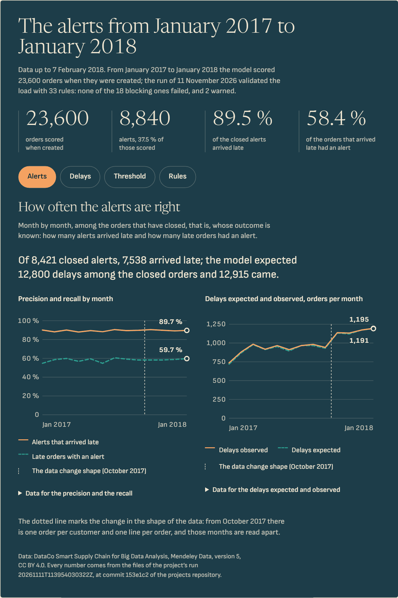
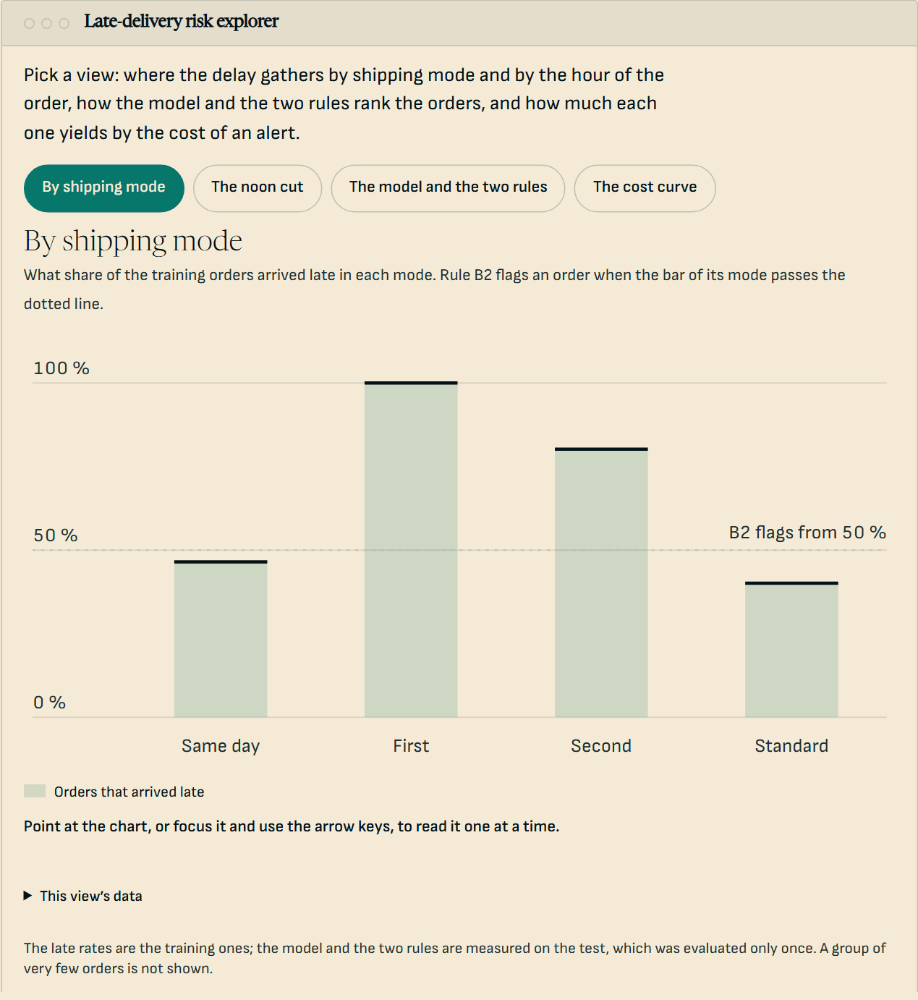
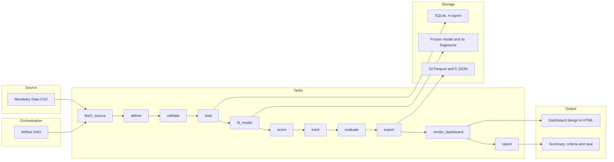

# Calibrated gradient boosting for late-delivery prediction

**English** · [Español](README.es.md)

Alerts for orders that will arrive late, computed when each order is created.



|  |  |
| --- | --- |
| **Result** | 7 of 9 success criteria met |
| **Tech stack** | Python, pandas, NumPy, SciPy, scikit-learn, SQLite, Parquet, Apache Airflow, Docker |
| **Techniques** | Binary classification, Gradient boosting, Isotonic calibration, Cost-based threshold, Time split with purges, Paired resampling |
| **To audit** (in Spanish) | [Model card](docs/model-card.md) · [Independent evaluation](docs/evaluation.md) · [Latest run: validation](reports/validation/latest.md) · [Latest run: results](reports/evaluation_summary.md) · [Decision log](docs/decisions.md) · [Test seal](reports/model_seal.json) |

## 1. Executive summary

### 1.1 Business problem and solution

**Business problem and target audience.** Built for the logistics operations teams of a company that ships worldwide and promises a delivery date on every order: today the delay only shows when the customer complains. The system estimates, at the moment each order is created and only from what is known then, the probability that it arrives late, to decide which orders to check, bring forward or move to another shipping mode. It was built on the 65,752 orders of a simulated supply chain, published under an open licence.

**Proposed solution.** A monthly flow that checks each delivery of orders against 33 rules, scores every new order with a calibrated, frozen classifier, and leaves three outputs:

- **Calibrated risk:** a probability of arriving late that can be read as such, with a calibration error of 0.016 on the test.
- **Alert:** the order whose risk reaches the threshold chosen by cost, 0.66 with the assumed costs.
- **Follow-up:** each month, how many of the alerts that have closed arrived late.

### 1.2 Success criteria and impact

**Criteria set before measuring.** Before the code was written, ten criteria were fixed, nine with a threshold: the model had to beat the late rate by shipping mode (B2) and that same rate split by the hour of the order (B5) on AUC, beyond the noise and on net benefit, and to be calibrated, with a calibration error of 0.03 at most. The expectation was written next to them: that it would beat B2 and not B5.

**Impact and main result.** On the test, 14,527 orders evaluated only once, the model ranks better than the rule by mode (AUC 0.773 against 0.742) and does not beat the two-variable rule (0.773 against 0.774): it meets 7 of the 9 criteria with a threshold and misses the two that compare it with B5. At the threshold chosen by cost it flags 37.1 % of the orders, and 89.4 % of those alerts arrived late.



## 2. Datasets and preparation

### 2.1 Sources, scope and granularity

- DataCo SMART SUPPLY CHAIN FOR BIG DATA ANALYSIS. Fabian Constante, Fernando Silva and António Pereira (2019), on Mendeley Data, version 5, doi.org/10.17632/8gx2fvg2k6.5. https://doi.org/10.17632/8gx2fvg2k6.5 (CC BY 4.0)

| Attribute | Specification |
| --- | --- |
| Original volume (M × N) | 180,519 rows × 53 columns (a single CSV of 95,910,149 bytes, cp1252 with CRLF) |
| Unit of analysis | The order, not the line: 65,752 orders, each with its lines aggregated |
| Period covered | Orders from 1 January 2015 to 31 January 2018 |
| Scope of the task | 62,897 orders not cancelled, of which 36,048 (57.3 %) arrived late |
| Selected variables | 28 of 53 columns, with the outcome ones in a separate stream that never reaches the model |

<details>
<summary>Fields available in the dataset (28)</summary>

| Column | Content | Unit | Data type |
| --- | --- | --- | --- |
| `Type` | Payment type (order: payment_type) | — | Text |
| `Days for shipping (real)` | Actual shipping days; with the scheduled ones they give the label (outcome, kept out of the model: real_days) | days | Integer |
| `Days for shipment (scheduled)` | Scheduled days, which the shipping mode sets (order: scheduled_days) | days | Integer |
| `Benefit per order` | The line’s profit, set aside as a precaution (outcome, kept out of the model: benefit_total) | the file’s currency | Decimal |
| `Delivery Status` | Delivery status: the label in other words (outcome, kept out of the model: delivery_status) | — | Text |
| `Late_delivery_risk` | The source’s label: whether the order arrived late (outcome, kept out of the model: source_label) | — | Integer |
| `Category Name` | Product category (line: category_name) | — | Text |
| `Customer Country` | Customer country (order: customer_country) | — | Text |
| `Customer Segment` | Customer segment (order: customer_segment) | — | Text |
| `Department Name` | Product department (line: department_name) | — | Text |
| `Market` | The order’s market (order: market) | — | Text |
| `Order Country` | The order’s destination country (order: order_country) | — | Text |
| `order date (DateOrders)` | When the order was created, to the minute and with no time zone (order: order_ts) | date and time | Text (ISO date and time) |
| `Order Id` | Order number: the key of the order and of its outcome (order and line: order_id) | — | Integer |
| `Order Item Cardprod Id` | Product card number (line: product_card_id) | — | Integer |
| `Order Item Discount` | The line’s discount (line: discount) | the file’s currency | Decimal |
| `Order Item Discount Rate` | The line’s discount rate (line: discount_rate) | share | Decimal |
| `Order Item Id` | Line number, unique in the file (line: line_id) | — | Integer |
| `Order Item Profit Ratio` | The line’s profit ratio, set aside as a precaution (outcome, kept out of the model: profit_ratio_mean) | share | Decimal |
| `Order Item Quantity` | Units in the line (line: quantity) | units | Integer |
| `Sales` | The line’s sales (line: sales) | the file’s currency | Decimal |
| `Order Item Total` | The line’s total: sales less the discount (line: item_total) | the file’s currency | Decimal |
| `Order Region` | The order’s destination region (order: order_region) | — | Text |
| `Order Status` | The order’s status when the file was extracted, unknown when it is created (outcome, kept out of the model: order_status) | — | Text |
| `Product Name` | Product name, without trailing spaces (line: product_name) | — | Text |
| `Product Price` | The product’s unit price (line: product_price) | the file’s currency per unit | Decimal |
| `shipping date (DateOrders)` | Shipping date, which already holds the actual days (outcome, kept out of the model: shipping_ts) | date and time | Text (ISO date and time) |
| `Shipping Mode` | Shipping mode: Standard Class, Second Class, First Class or Same Day (order: shipping_mode) | — | Text |

</details>

Of the 53 columns, the flow carries 28. Left out are the 15 personal ones, dropped when the file is read, 4 that repeat another, 3 that are constant or empty, the 2 category and department codes, whose names are carried, and Order Profit Per Order, which repeats Benefit per order.

### 2.2 Cleaning and quality rules

- **Validation in three levels.** Each delivery goes through 33 rules: 18 block (they reject the delivery and leave the previous load untouched), 6 warn and 9 inform. In the real run all 15 deliveries were loaded and none was rejected.
- **Personal data dropped on reading.** The 15 personal columns (names, email, password, street, postcodes, cities, states, customer identifiers, latitude and longitude) are used only by the reader’s checks and reach no file; an unmasked email or password rejects the source.
- **Leakage set aside.** The 8 columns that give the result away or are unknown when the order is created (the label, the actual days, the delivery status, the shipping date, the order status and the three profit ones) go to a separate outcomes stream; an order has no label in the store until its outcome arrives.
- **Cancelled orders.** The 2,855 cancelled orders (7,754 lines) have no delivery time: they stay out of training and of the metrics, but are scored like any new order and counted.
- **Blanks and corrections.** A value that does not exist stays null, not zero: an order not scored has no risk and an open one has no actual days. Product names lose their trailing spaces (1,774 lines) and each line’s total is accepted within 0.015 of sales less the discount. Order Zipcode is empty in 86.2 % of the rows and is not carried.
- **A change of shape.** From October 2017, 8,340 of the 8,403 orders carry a single line, where before they carried one to five: that stretch is reported apart.

## 3. Architecture and methodology

The system runs as a monthly flow of eleven sequential tasks, the same from the command line (python -m latedel run) and from Apache Airflow’s latedel_monthly DAG in Docker: fetch_source → deliver → validate → load → fit_model → score → track → evaluate → export → render_dashboard → report.

### 3.1 Source and ingestion

- **Verified download (fetch_source).** It downloads the CSV over HTTPS from Mendeley Data, which redirects to an Amazon S3 bucket: every hop must go to an allowed host, with 3 redirects at most and a cap of 128 MiB, and the file is accepted only if its SHA-256 matches the one fixed in the configuration, the one Mendeley’s file API publishes. Here the fingerprint does verify the download, because there is a trusted value to compare it with.
- **A simulated source system (deliver).** Since the file is historical, the task splits it into a launch with what was known on 7 January 2017, thirteen monthly deliveries and a closing on 7 February 2018 that only brings outcomes. Each delivery carries two streams: the orders created in the period and the outcomes that became known in it, each by its own date. With no delivery left, the run ends as no_delivery.
- **Quality gate (validate).** It applies the 33 rules to the delivery. If a blocking rule fails, the delivery is rejected and the run stops without touching anything: what came before stays intact, byte for byte.

### 3.2 Orchestration and transformation

- **Flow control (Apache Airflow).** The latedel_monthly DAG runs once a month, with no catchup and one run and one task active at a time; the keys are required from the environment, with no default. It was tested in Docker: pytest -m docker built the image and ran airflow dags test twice in quick mode on a synthetic source, the launch and the January 2017 delivery, with the frozen model identical (71.6 s). The real run on the Mendeley file was made from the command line.
- **Transactional transformation (load).** It loads the accepted delivery into SQLite in a single transaction, all or nothing, with layered SQL files (staging and marts) and checks inside that same transaction; a delivery its run’s validation did not approve is rejected before anything is written.
- **One writer and an ordered close.** Each task takes the data folder’s lock and a second process is refused without writing anything. A run counts as closed only at the end, in this order: SQLite, the runs table, the summary, the HTML, the deliveries manifest and the state file, so a process that dies halfway leaves nothing that says ok.



### 3.3 Storage and data modelling

- **Transactional and audit database (SQLite).** It keeps orders and outcomes in separate tables (an order has no label until its outcome arrives), the insert-only scores and model registry, each run with its fingerprint and the verdict of each validation rule.
- **Frozen model and seal.** The model is trained once, at the launch, and its artefact is loaded only if its SHA-256 matches the one recorded, before it is deserialised. The seal reports/model_seal.json keeps the launch configuration and the first test result, and is never rewritten: another configuration is reported apart, as after the seal.
- **Star-schema analytical layer (Parquet).** The export task writes 20 Parquet tables, 10 dimensions and 10 facts with 9 one-to-many relationships that filter one way, with unique keys and referential integrity checked before writing: 2,229,845 bytes in all. Each file carries in its metadata the run, the calculation date, the source CSV’s fingerprint and the licence attribution.

<details>
<summary>Data model (20 tables)</summary>

| Table | Kind | Columns | Joins |
| --- | --- | --- | --- |
| `Order date` | dimension | 10 | — |
| `Month` | dimension | 5 | — |
| `Shipping mode` | dimension | 5 | — |
| `Market, region and country` | dimension | 4 | — |
| `Product` | dimension | 4 | — |
| `Customer segment` | dimension | 2 | — |
| `Payment type` | dimension | 2 | — |
| `Frozen model` | dimension | 12 | — |
| `Run` | dimension | 15 | — |
| `Calculation date` | dimension | 3 | — |
| `Orders, with their risk and alert` | fact | 27 | Order date (`order_date_key`); Shipping mode (`mode_key`); Market, region and country (`geo_key`); Product (`main_product_key`); Customer segment (`segment_key`); Payment type (`payment_key`) |
| `Monthly follow-up of the alerts` | fact | 12 | Month (`month_key`); Shipping mode (`mode_key`) |
| `Each method’s metrics` | fact | 14 | — |
| `Criteria and verdicts` | fact | 12 | — |
| `ROC curve` | fact | 6 | — |
| `Calibration by bins` | fact | 7 | — |
| `Sensitivity to the costs` | fact | 7 | — |
| `Columns that give the result away` | fact | 6 | — |
| `Each variable’s importance` | fact | 3 | — |
| `Validation rules` | fact | 8 | Run (`run_key`) |

</details>

### 3.4 Experimentation and machine learning

- **Rigour and traceability protocol.** The ten criteria and their thresholds were fixed and committed to Git before the first line of code, together with the written expectation: that the model would beat B2 and not B5. Every decision is in docs/decisions.md (D01-D94) with its context, options, reason and status; the model’s grid is fixed, so are the seeds (0 for the classifier and 0 for the resampling), and the versions are pinned with == in requirements.txt. The test was evaluated once and kept in a seal that is never rewritten.

#### 3.4.1 Feature engineering and baseline

Three nested sets, from an allowed list and only with what exists when the order is created. F0: the shipping mode and its scheduled days. F1: F0 plus the order’s market, region and country, the customer’s country and segment, the payment type, the main product, category and department, and the order’s lines, units, sales, total and discounts. F2: F1 plus the hour, weekday, day of the month and month of creation. V1 chose F2. The baseline the model must beat is B2, the training late rate by shipping mode; the toughest is B5, that same rate split by the order’s half of the day, before or from noon.

**Baselines: which rules is the model measured against?** (D15)

- **Selected alternative:** Six rules, all with training rates: B0 all late, B1 First Class only, B2 the rate by mode, B3 two scheduled days or fewer, B4 Standard Class only (a negative control) and B5 the rate by mode and half of the day; B2 and B5 also with their own threshold chosen on V2. The model has to beat the best simple rule known before looking at the test, not a weak rule picked to lose. If it only matches B5, the honest conclusion is that a two-variable rule does the same job.
- **Rejected alternatives:** B2 only: It would leave out the noon cut, already seen in training.
- **Rejected alternatives:** B0 to B4, as the research had: It does not measure whether the model learns anything beyond the order’s half of the day.

#### 3.4.2 Modelling decisions and ablation (ADR)

<details>
<summary>4 decisions, each with what was rejected</summary>

**Choice of classifier** (D12)

- **Selected alternative:** scikit-learn’s HistGradientBoostingClassifier with a fixed grid of eight configurations per variable set (24 fits of 300 iterations, no early stopping), explicit ordinal encoding and seed 0. scikit-learn was already in the stack. The small grid costs about 20 s with the three sets, and early stopping uses a random split inside training, which breaks the order in time and the reproducibility.
- **Rejected alternatives:** LightGBM or XGBoost: They add a technology with no reason the research found.
- **Rejected alternatives:** Logistic regression: It would mean writing the interactions by hand, such as mode with the hour of the order.
- **Rejected alternatives:** The research’s single configuration: It cannot choose between the variable sets without touching the test.

**Selection and calibration** (D13)

- **Selected alternative:** Choose the candidate by log loss on V1, calibrate it with isotonic regression over the frozen classifier (FrozenEstimator), also on V1, and choose the threshold on V2. Log loss rewards the quality of the probability, which is what the threshold needs, and keeping V2 apart avoids choosing the threshold on the calibrator’s rows. F2 won with a learning rate of 0.05, 15 leaves and 100 orders per leaf (loss 0.5005 on V1).
- **Rejected alternatives:** Choosing by AUC: It ignores calibration.
- **Rejected alternatives:** Choosing by net benefit: It depends on the assumed costs.
- **Rejected alternatives:** Calibrating and choosing the threshold on the same validation: It chooses the threshold on the calibrator’s rows, optimistically.

**Assumed costs and the alert threshold** (D14)

- **Selected alternative:** Costs declared in generic units: an alert costs 5, a delay 20 and the alert avoids half of the delay (break-even point 0.5). The threshold is the value from 0.01 to 0.99 that maximises net benefit on V2, and the sensitivity repeats the choice at the 17 break-even points from 0.10 to 0.90. The data hold no costs and no open source gives a defensible one; what decides the threshold is the ratio, and a choice with no source is declared as such. With these costs the model’s threshold is 0.66.
- **Rejected alternatives:** The research’s illustrative values: They give a break-even point of 0.33, below the rate of every mode: flagging almost everything is trivial and no model can help.
- **Rejected alternatives:** F1 or Youden’s index: They ignore the costs, and F1 chose a threshold that flagged 99.9 % of the orders.
- **Rejected alternatives:** No default value, only the curve: The dashboard would be left with no list of alerts.

**Columns that give the result away** (D06)

- **Selected alternative:** Exclude the four that come after the order and, as a precaution, the three profit ones, with the label in a separate outcomes stream, an allowed list, its own error (LeakageError) and tests that prevent it. Next to the shipping mode, the actual days and the delivery status give an AUC of 1.000 on V2 and the shipping date 0.998, against 0.743 for the mode alone: a model with them knows the result only once the order has arrived. A trap also stops the launch if the chosen model’s AUC reaches 0.95 on V1.
- **Rejected alternatives:** Exclude Delivery Status only: It is less than what gives the result away.
- **Rejected alternatives:** Keep the profit columns: Nobody records when they are computed: they are set aside until that is known.

</details>

#### 3.4.3 Validation protocol (time split and sealed test)

A split in time by order date, with 7-day purges between blocks: training from 1 January 2015 to 30 June 2016 (29,894 orders), V1 to choose and calibrate (4,649), V2 for the threshold (5,032) and the test, from 8 January 2017 to 30 September 2017 (14,527 orders), evaluated once under the seal. The 8,043 orders after the change of shape are reported apart. The 95 % intervals come from 1,000 paired resamples of the test orders, with the same indices for both scores.

### 3.5 Consumption and governance

- **Consumption interfaces.** The Parquet tables feed the design of a dashboard: an HTML file of 130,972 bytes, with no external resources, holding the semantic model, the relationships and 5 pages drawn with the real numbers. For this site come 5 small JSON files, with no order number and the cells of fewer than 20 orders hidden.
- **Governance artefacts.** The flow writes the evaluation summary with each criterion’s verdict, the seal and the latest validation; with them go the model card (intended use, data, methods, limits and reproducibility), the decision log and a runbook for every known failure.
- **Full lineage.** Every Parquet table and every file for the site keeps the run key, the calculation date and the source CSV’s SHA-256 fingerprint; the data on this page are those of run 20261111T113954030322Z.

## 4. Final product

### 4.1 Operational deliverables

- **Automation.** A monthly flow was set up that, with each delivery of new orders and already known outcomes, checks it against 33 rules: if something serious fails, the delivery is rejected and the previous load stays. It drops the 15 personal columns before writing anything, loads the orders into a layered SQL database and scores each new order with the model, which is trained once and stays frozen. Since the file is historical, the flow splits it into a launch and thirteen monthly deliveries. It is built for Airflow, where it was tested in Docker.
- **Model in use.** Each order gets a risk when it is created, from the data that exist at that moment, and those above the threshold are flagged: a Same Day order created at 19 gets a risk of 1.0 and an alert; one created at 3, a risk of 0.0 and none. From January 2017 to January 2018, 23,600 orders were scored and 8,840 were given an alert; of the 8,421 alerts that had closed, 7,538 arrived late. The model expected 12,800 delays among the closed orders and there were 12,915. The alerts concentrate in the fast modes: Standard Class, with 14,104 orders scored, got just 3.
- **Dashboard.** Everything ends in the tables of a star schema and in the dashboard shown at the top, drawn from the run’s real numbers: four views, from the alerts to the threshold and the rules, with the assumed costs in view.

### 4.2 Reading the current results

Snapshot of the last validated run (20261111T113954030322Z, with data to 7 February 2018), from January 2017 to January 2018:

- **Orders scored.** 23,600 new orders in 13 monthly deliveries; 8,840 were given an alert (37.5 %).
- **Closed alerts.** Of the 8,421 alerts whose outcome is known, 7,538 arrived late (89.5 %).
- **Calibration in use.** Among the 22,570 closed orders, the model expected 12,800 delays and there were 12,915.
- **Last month.** January 2018: 2,123 orders scored and 826 alerts.
- **Alerts on cancelled orders.** 419 alerts (4.7 %) fell on orders that were later cancelled: they are counted, but stay out of the net benefit.

## 5. Conclusion

### 5.1 Evaluation against the success criteria

**Status:** 7 of 9 success criteria met.

**Not met:**

- C03: the 95 % interval of the AUC difference against B5 runs from −0.006 to 0.005 and holds zero.
- C05: with its own threshold, the model’s net benefit does not beat B5’s: 1,459.4 against 1,467.3 per 1,000 orders.

The verdict against the nine criteria with a threshold set before the code was written; the tenth, C10, is informational:

- **Against the rule by mode (C01, C02, C07).** The model ranks better: AUC 0.773 against 0.742, a difference of 0.031 with a 95 % interval of 0.026 to 0.036, and a Brier score of 0.1767 against 0.1890.
- **Net benefit and alerts (C04, C08, C09).** With the assumed costs, 1,459.4 per 1,000 orders against 1,323.1 for B2 at 0.5; with the same 4,998 alerts, 4,499 late orders against 4,421; and never less than B2 at the 17 break-even points.
- **Calibration (C06).** A calibration error of 0.016 against a maximum of 0.03, with a bias of −0.006 against a maximum of 0.02.
- **Against the two-variable rule (C03, C05): does not beat it.** AUC 0.773 against B5’s 0.774, and 1,459.4 against 1,467.3 of net benefit. The model learns the shipping mode and the noon cut, and nothing else: permuting the mode drops the AUC by 0.262, the hour by 0.046 and no other variable by more than 0.0012.
- **The stretch after the change of shape (C10, informational).** In the 8,043 orders from October 2017 the order repeats: AUC 0.779 for the model, 0.777 for B5 and 0.745 for B2.

**Comparison on the test (14,527 orders)**

| Method evaluated | AUC on the test | Role in the system |
| --- | --- | --- |
| Calibrated gradient boosting | 0.773 | Risk and alert engine: 1,459.4 of net benefit per 1,000 orders |
| B5: rate by mode and half of the day | 0.774 | Yields as much as the model, with an auditable rule: 1,467.3 |
| B2: rate by shipping mode | 0.742 | The baseline to beat: 1,323.1 |
| B3: two scheduled days or fewer | 0.716 | Comparison rule: 1,337.5 |
| B1: First Class only | 0.632 | Comparison rule: 754.1 |
| B0: all late | 0.500 | Flags every order: 699.0 |
| B4: Standard Class only | 0.284 | Negative control: −638.5 |

### 5.2 Methodological limits

The system shows that a calibrated classifier, measured against simple rules with criteria set beforehand, can say with numbers when it adds nothing. The data look generated: within Second and Standard Class the actual days spread almost evenly, First Class always takes 2 days and in Same Day the hour of the order decides the result without a single exception, so the result holds for this file and not for a company. The costs are assumed and the threshold depends on them; the test was evaluated once, with one split and one file; cancelled orders are scored, but the model says nothing about a cancellation; profit was left out as a precaution; and it does not predict at dispatch, because the shipping date already holds the delay.

### 5.3 Future work

- **A scheduled run on the real file.** The DAG was tested in Docker on a synthetic source and the real run was made from the command line: the monthly DAG still has to run on the Mendeley file.
- **Real costs and another operation.** With a company’s measured costs, repeat the threshold choice as a new analysis, after the seal, and try the model on another operation’s data, where mode and hour may not be the whole signal.
- **A scoring service.** The scoring function is ready to be wrapped; publishing it as an API awaits a decision (D33).

## Run it

Python 3.11, on PowerShell, from the repository folder:

```powershell
py -3.11 -m venv .venv
.venv\Scripts\python -m pip install -r requirements-dev.txt
$env:PYTHONPATH = "src"

# Tests, without the ones that need the real file or Docker
.venv\Scripts\python -m pytest

# Quick end-to-end run on synthetic data; everything stays in data\quick\, which is not versioned
.venv\Scripts\python -m latedel make-fixture data\quick\dataco_fixture.csv
.venv\Scripts\python -m latedel replay --config config\pipeline.quick.toml

# Real run: downloads the CSV (96 MB) if it is missing and runs the fifteen deliveries, then the run without one
.venv\Scripts\python -m latedel replay
.venv\Scripts\python -m latedel run

# Tests with the real file and with Docker
.venv\Scripts\python -m pytest -m real_data
.venv\Scripts\python -m pytest -m docker

# Documentation figures and the results block of README.es.md
.venv\Scripts\python -m latedel figures
.venv\Scripts\python -m latedel docs-sync
```

Every operation, with its failures and how to recover, is in the [runbook](docs/runbook.md) (in Spanish).

## Source and licence

Data source: Constante, Fabian; Silva, Fernando; Pereira, António (2019), 'DataCo SMART SUPPLY CHAIN FOR BIG DATA ANALYSIS', Mendeley Data, v5, http://doi.org/10.17632/8gx2fvg2k6.5, CC BY 4.0 (https://creativecommons.org/licenses/by/4.0/). Changes: the 15 personal columns dropped on reading, the columns that give the result away moved to a flow of their own, lines added up per order, the history split into monthly deliveries, and risks, alerts, metrics and criteria calculated.

The raw data is not versioned: the flow downloads the file and checks its hash. No output carries personal data.
