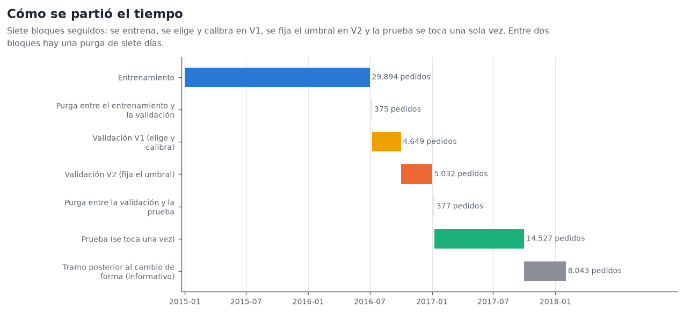
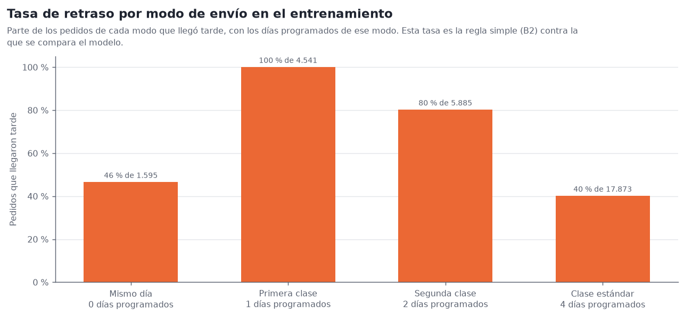
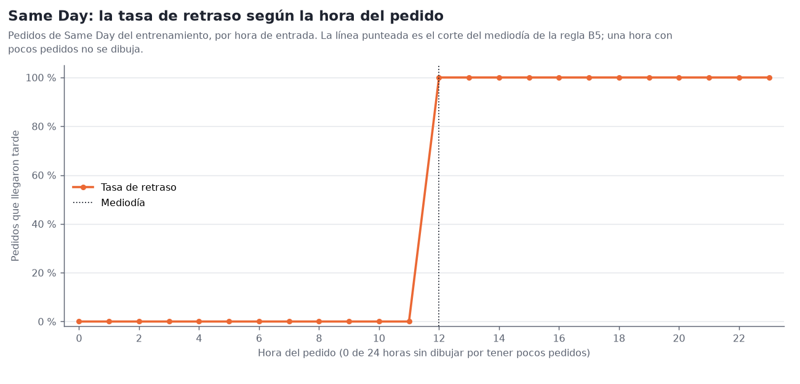
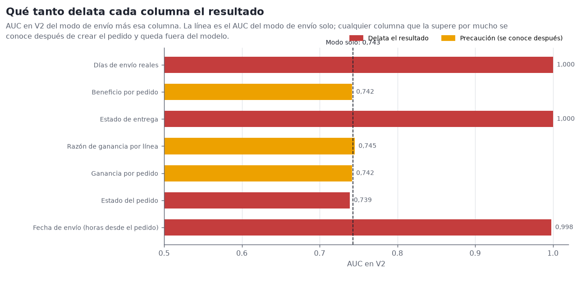
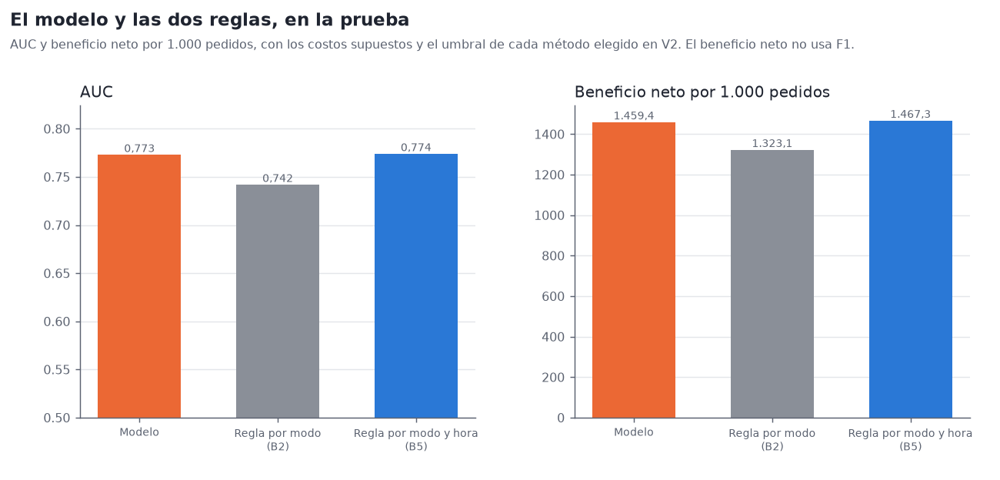
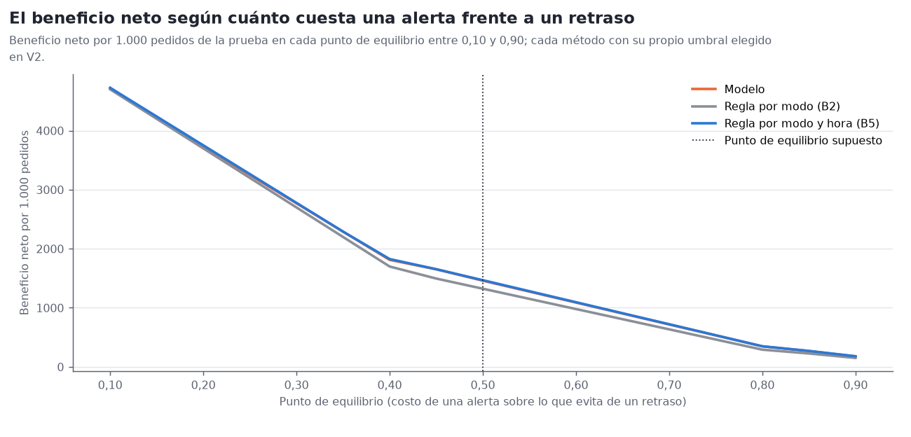
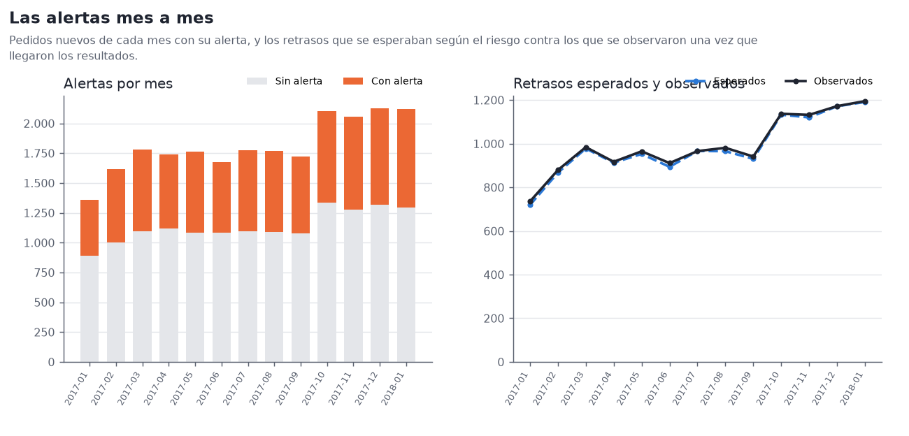

# Pedidos que van a llegar tarde, antes de que lleguen

Un flujo mensual que toma los pedidos de una empresa que vende en línea y despacha a todo el mundo, los valida, descarta los datos personales al leerlos, estima para cada pedido nuevo, con lo que se sabe al crearlo, la probabilidad calibrada de que llegue tarde, marca los que pasan un umbral elegido por costo y sigue mes a mes cómo resultan esas alertas. Y mide, contra criterios fijados antes de escribir el código, si el modelo supera a dos reglas simples: supera a la primera y no a la segunda.

## El problema

Una empresa que despacha a todo el mundo promete una fecha de entrega en cada pedido, pero la demora aparece recién cuando ya pasó: el cliente reclama y nadie lo había visto venir. Logística no sabe qué pedidos revisar, adelantar o cambiar de modo de envío; atención al cliente recibe el reclamo sin aviso; dirección no sabe cuánto cuesta una alerta frente a cuánto cuesta un retraso, ni si un modelo agrega algo a una regla que cualquiera puede escribir.

El dato de este proyecto es el de una cadena de suministro simulada, «DataCo SMART SUPPLY CHAIN», publicado en Mendeley Data (CC BY 4.0): 180.519 líneas de 65.752 pedidos del 2015-01-01 al 2018-01-31, en las que el 57,3 % de los pedidos no cancelados llega tarde. Trae una trampa conocida: los trabajos publicados sobre este conjunto informan un AUC de hasta 0,89 con columnas que solo existen después del envío, y una de ellas, `Delivery Status`, es la respuesta escrita con otras palabras. Un equipo que copiara ese modelo pondría en uso un clasificador que conoce el resultado recién cuando el pedido ya llegó.

## La solución

Un flujo mensual que, con cada entrega de pedidos nuevos y de resultados ya conocidos, la valida con 33 reglas (18 bloquean la entrega, 6 advierten y 9 informan), descarta las 15 columnas personales antes de escribir nada, carga la entrega en SQLite de forma todo o nada, puntúa cada pedido nuevo con un clasificador de árboles entrenado y congelado en el lanzamiento, marca los que superan un umbral elegido por beneficio neto con costos supuestos y declarados, sigue cada mes las alertas que ya cerraron y escribe las tablas de un tablero de Power BI en modelo estrella, el diseño del tablero en HTML y cinco archivos pequeños para el sitio. Si una entrega está dañada, la rechaza y deja todo lo anterior intacto, byte a byte.

El resultado central no es el modelo sino una medición: el clasificador se compara con la tasa de retraso por modo de envío (B2) y con esa misma tasa partida por la hora del pedido (B5), con diez criterios fijados antes de escribir el código. La prueba se evaluó una sola vez y quedó sellada.

## Los resultados

Corrida real del 2026-11-11 sobre el archivo de Mendeley (huella SHA-256 `fa6d022e…0aa6`): el lanzamiento al 2017-01-07, trece entregas mensuales (2017-01 a 2018-01), el cierre al 2018-02-07 y una corrida sin entrega, dieciséis corridas en 105 segundos. El modelo se entrenó, se calibró y eligió su umbral solo con pedidos de 2015 y 2016; la prueba, los 14.527 pedidos no cancelados del 2017-01-08 al 2017-09-30, se evaluó una sola vez y quedó en el sello `reports/model_seal.json`, que no se reescribe. Los criterios se fijaron y se confirmaron en Git antes del primer código (`docs/requirements.md`, sección 8.1; `docs/decisions.md`, D16), junto con lo que se esperaba: que el modelo superara a B2 y no a B5. **Así salió: el modelo supera 7 de los 9 criterios con umbral y no supera C03 ni C05, los dos que lo comparan con la regla de dos variables.** El bloque siguiente no se escribe a mano: lo copia `python -m latedel docs-sync` de `reports/evaluation_summary.md`, que escribe el propio flujo.

<!-- results:start -->
Evaluación al 2018-02-07 (corrida `20261111T113954030322Z`).

El modelo supera 7 de 9 criterios con umbral y no supera C03 ni C05.

Costos supuestos y declarados, en unidades genéricas: alerta 5,0, retraso 20,0, efecto 0,50 (punto de equilibrio 0,50). Los criterios y sus umbrales se fijaron antes de construir (`docs/requirements.md`, sección 8.1).

| Criterio | Qué mide | Veredicto |
| --- | --- | --- |
| C01 | Discriminación frente a la regla por modo | El modelo supera a la regla por modo: AUC 0,773 frente a 0,742. |
| C02 | Mejora fuera del ruido frente a la regla por modo | El modelo supera a la regla por modo fuera del ruido: la diferencia de AUC es 0,031, con un intervalo del 95 % de 0,026 a 0,036. |
| C03 | Mejora fuera del ruido frente a la regla de dos variables | El modelo no supera a la regla de dos variables: la diferencia de AUC es −0,001, con un intervalo del 95 % de −0,006 a 0,005. |
| C04 | Beneficio neto frente a la regla de la investigación (B2 a 0,5) | El modelo supera a la regla de la investigación (B2 a 0,5) en beneficio neto: 1.459,4 frente a 1.323,1 u. por cada 1.000 pedidos. |
| C05 | Beneficio neto frente a la regla de dos variables con su propio umbral | El modelo no supera a la regla de dos variables en beneficio neto con su propio umbral (0,80): 1.459,4 frente a 1.467,3 u. por cada 1.000 pedidos. |
| C06 | Calibración en la prueba | El modelo supera el control de calibración: ECE 0,016 frente a un máximo de 0,03 y sesgo −0,006 frente a un máximo de 0,02 en valor absoluto. |
| C07 | Brier frente a la regla por modo | El modelo supera a la regla por modo en Brier: 0,1767 frente a 0,1890 (menor es mejor). |
| C08 | Con el mismo número de alertas que B2 a 0,5 | Con el mismo número de alertas que B2 a 0,5 (k = 4.998), el modelo supera a B2: 4.499 pedidos tarde frente a 4.421. |
| C09 | Sensibilidad a los costos | El modelo supera o iguala a B2 en beneficio neto en los 17 puntos de equilibrio (0,10 a 0,90). |
| C10 | Tramo posterior al cambio de forma (informativo) | Informativo, sin umbral: en el tramo posterior al cambio de forma (8.043 pedidos) el AUC del modelo es 0,779, el de B2 0,745 y el de B5 0,777; el modelo marca el 37,7 % de los pedidos con precisión 0,898 y recall 0,588. |

**Prueba (2017-01-08 a 2017-09-30)**

| Método | AUC | Brier | ECE | Marcados (%) | Precisión | Recall | BN por 1.000 pedidos (u.) |
| --- | --- | --- | --- | --- | --- | --- | --- |
| Modelo | 0,773 | 0,1767 | 0,016 | 37,1 | 0,894 | 0,581 | 1.459,4 |
| B2 tasa de retraso por modo | 0,742 | 0,1890 | 0,003 | 34,4 | 0,885 | 0,534 | 1.323,1 |
| B5 tasa por modo y hora del pedido | 0,774 | 0,1751 | 0,006 | 37,3 | 0,893 | 0,585 | 1.467,3 |

**Tramo posterior al cambio de forma (informativo)**

| Método | AUC | Brier | ECE | Marcados (%) | Precisión | Recall | BN por 1.000 pedidos (u.) |
| --- | --- | --- | --- | --- | --- | --- | --- |
| Modelo | 0,779 | 0,1747 | 0,007 | 37,7 | 0,898 | 0,588 | 1.501,3 |
| B2 tasa de retraso por modo | 0,745 | 0,1875 | 0,001 | 35,0 | 0,889 | 0,540 | 1.362,1 |
| B5 tasa por modo y hora del pedido | 0,777 | 0,1737 | 0,003 | 37,9 | 0,898 | 0,590 | 1.505,7 |

**Validación (V2), no es la prueba**

| Método | AUC | Brier | ECE | Marcados (%) | Precisión | Recall | BN por 1.000 pedidos (u.) |
| --- | --- | --- | --- | --- | --- | --- | --- |
| Modelo | 0,776 | 0,1731 | 0,011 | 37,7 | 0,899 | 0,588 | 1.504,4 |
| B2 tasa de retraso por modo | 0,743 | 0,1865 | 0,001 | 35,3 | 0,892 | 0,545 | 1.381,2 |
| B5 tasa por modo y hora del pedido | 0,781 | 0,1728 | 0,003 | 37,7 | 0,899 | 0,588 | 1.504,4 |
<!-- results:end -->

**Cómo leerlo.**

- **El modelo encuentra lo que hay en los datos: el modo de envío y el corte del mediodía.** Supera a la regla por modo (B2) en discriminación (AUC 0,773 frente a 0,742, con una diferencia de 0,031 y un intervalo del 95 % de 0,026 a 0,036; C01 y C02), en Brier (0,1767 frente a 0,1890; C07), en beneficio neto (1.459,4 frente a 1.323,1 u. por cada 1.000 pedidos; C04) y con el mismo número de alertas (entre 4.998 alertas, 4.499 pedidos tarde frente a 4.421; C08), y no pierde contra B2 en ninguno de los 17 puntos de equilibrio de costo (C09). La diferencia sale de Same Day: B2 le da a todo el modo la misma tasa (0,4652), y en el entrenamiento los 853 pedidos Same Day creados antes de las 12:00 llegaron a tiempo y los 742 creados desde las 12:00 llegaron tarde, sin una excepción.
- **El modelo no supera a la regla de dos variables (B5), y ese es el resultado del proyecto.** B5 es la tasa de retraso del entrenamiento por modo y por franja del pedido, antes o desde las 12:00. Su AUC es 0,774 y el del modelo 0,773: la diferencia es −0,001, con un intervalo del 95 % de −0,006 a 0,005, que contiene el cero. **C03 no supera.** En beneficio neto, cada uno con su umbral elegido en V2, B5 da 1.467,3 u. por cada 1.000 pedidos y el modelo 1.459,4. **C05 no supera.** El plan lo escribió antes de medir (D16): dentro de cada celda de B5 no se vio ninguna otra señal, así que el modelo aprende una regla de dos variables y nada más. La importancia por permutación en V2 dice lo mismo: permutar el modo de envío hace caer el AUC 0,262 y la hora del pedido 0,046; ninguna otra variable lo mueve más de 0,0012, y la región, el mercado y el producto, nada.
- **Las probabilidades están calibradas.** En la prueba, el error de calibración esperado es 0,016 y el sesgo −0,006 (C06), con una tasa de retraso observada del 57,0 %. Un 0,7 de riesgo quiere decir, en estos datos, que llegan tarde unos 7 de cada 10 pedidos así.
- **El tramo posterior al cambio de forma de los datos cuenta lo mismo.** Desde octubre de 2017 casi todos los pedidos traen una sola línea; en esos 8.043 pedidos el AUC del modelo es 0,779, el de B5 0,777 y el de B2 0,745 (C10, informativo).
- **Los costos son supuestos y lo dicen.** Una alerta cuesta 5, un retraso 20 y la alerta evita la mitad del retraso, en unidades genéricas (punto de equilibrio 0,5; D14). Los datos no traen costos y no hay una fuente pública defendible; con otros costos el umbral cambia, y la sensibilidad (C09, `fact_cost_sensitivity` y la figura de la curva de costo) muestra cómo. Un cambio de costos después del sello es un análisis nuevo: no reemplaza el resultado sellado.
- **Lo que esto quiere decir para un equipo de logística:** con lo que se sabe al crear un pedido, una regla escrita a mano, la tasa por modo y si el pedido entró antes o después del mediodía, avisa igual de bien que el modelo. El aporte del proyecto es haberlo medido con la fuga cerrada (junto al modo de envío, los días reales y el estado de entrega dan un AUC de 1,000 en V2 y la fecha de envío 0,998, frente a 0,743 del modo solo) y dejar el flujo mensual, el seguimiento de las alertas y el tablero listos por si los datos traen otra señal.
- **El seguimiento de las alertas, en la corrida real.** De enero de 2017 a enero de 2018 se puntuaron 23.600 pedidos nuevos y 8.840 quedaron con alerta. De las 8.421 alertas que cerraron con un resultado, 7.538 llegaron tarde; de los 12.915 pedidos cerrados que llegaron tarde, 5.377 no tuvieron alerta. El modelo esperaba 12.800 retrasos entre los pedidos cerrados y hubo 12.915.
- **Lo que sigue pendiente:** la evaluación independiente, que todavía no se hizo (la hará un agente que no construyó el proyecto, plan, sección 25), la corrida programada de Airflow sobre el archivo real (se probó en Docker con una fuente sintética) y el `.pbix`, que requiere Power BI Desktop. El detalle está en la [ficha del modelo](docs/model-card.md).















## En qué consiste

Once tareas que corren siempre en este orden, las mismas desde la línea de comandos (`python -m latedel run`) y desde el DAG de Apache Airflow (`latedel_monthly`, una vez por mes, el día 2):

```mermaid
flowchart LR
  A[fetch_source<br/>CSV con huella fijada] --> B[deliver<br/>la siguiente entrega]
  B --> C[validate<br/>33 reglas]
  C --> D[load<br/>SQLite, todo o nada]
  D --> E[fit_model<br/>entrena y congela en el lanzamiento]
  E --> F[score<br/>puntúa los pedidos nuevos]
  F --> G[track<br/>las alertas que cerraron]
  G --> H[evaluate<br/>V2 y, una vez, la prueba]
  H --> I[export<br/>20 Parquet y 5 JSON]
  I --> J[render_dashboard<br/>HTML]
  J --> K[report<br/>cierra la corrida]
```



La segunda tarea hace de sistema de origen: como el archivo es histórico, el flujo lo reparte en un lanzamiento con lo conocido al 2017-01-07, trece entregas mensuales y un cierre al 2018-02-07 que solo trae resultados. Cada entrega tiene dos flujos: los pedidos creados en el período y los resultados que se conocieron en él, cada uno por su propia fecha; un pedido no tiene etiqueta en el almacén hasta que llega su resultado. Con ninguna entrega pendiente, la corrida termina como `no_delivery` y corta el resto. La tercera tarea corta el flujo, sin tocar nada, si la entrega no cumple el contrato.

El modelo se entrena una sola vez, en el lanzamiento, y queda congelado: su artefacto se carga solo si su SHA-256 coincide con el registrado, y cada corrida mensual puntúa sus pedidos nuevos una vez, sin cambiar nunca un puntaje ya emitido. El sello guarda la configuración del lanzamiento y el primer resultado de la prueba; una evaluación con otra configuración se informa aparte, como posterior al sello. Una corrida solo se da por cerrada al final, en este orden: SQLite, la tabla exportada de corridas, el resumen, el HTML, el manifiesto de entregas y el archivo de estado, de modo que un proceso que muere a la mitad no deja nada que diga `ok` mientras otro archivo dice `running`. Un solo proceso escribe la carpeta de datos a la vez: cada tarea toma el bloqueo `data/interim/pipeline.lock`, y un segundo proceso se rechaza sin escribir nada (D82).

Sobre la integridad de la descarga: la fuente llega por HTTPS desde Mendeley, que redirige a un depósito de Amazon S3; cada salto debe ir a un host de la lista (`data.mendeley.com` y ese depósito), con a lo sumo tres redirecciones y un tope de 128 MiB, y el archivo se acepta solo si su SHA-256 es el fijado en la configuración (`fa6d022e…0aa6`, el que publica la API de archivos de Mendeley).

## Los datos

| | |
| --- | --- |
| Fuente | Mendeley Data, «DataCo SMART SUPPLY CHAIN FOR BIG DATA ANALYSIS», versión 5, de Constante, Silva y Pereira (http://doi.org/10.17632/8gx2fvg2k6.5) |
| Archivo | `DataCoSupplyChainDataset.csv`, 95.910.149 bytes, cp1252 con CRLF, 53 columnas; el archivo de registros de navegación del mismo conjunto no se usa (trae señales posteriores al pedido) |
| Período | Pedidos del 2015-01-01 al 2018-01-31 |
| Filas | 180.519 líneas de 65.752 pedidos; la unidad del modelo es el pedido, no la línea |
| Cancelados | 2.855 pedidos completos (7.754 líneas) quedan fuera de la tarea: se puntúan como cualquier pedido nuevo y se cuentan; quedan 62.897 pedidos para la tarea |
| Etiqueta | Un pedido no cancelado llega tarde si sus días reales superan a los programados: 36.048 de 62.897 (57,3 %) |
| Fuga | `Days for shipping (real)`, `Delivery Status` y `shipping date` delatan el resultado, y `Order Status` no se conoce al crear el pedido; las tres de rentabilidad se excluyen por precaución. Todas quedan en un flujo de resultados aparte, detrás de cuatro guardas |
| Datos personales | 15 columnas (nombres, correo, contraseña, calle, códigos postales, ciudades y estados, identificadores del cliente, latitud y longitud) se descartan en la lectura y no llegan a ningún archivo |
| Cambio de forma | Desde 2017-10 cada pedido tiene una línea (8.340 de 8.403 pedidos) en lugar de una a cinco: ese tramo se informa aparte |

La partición en el tiempo (pedidos no cancelados, con purgas de siete días entre bloques):

| Bloque | Pedidos del | al | Pedidos | Para qué |
| --- | --- | --- | ---: | --- |
| Entrenamiento | 2015-01-01 | 2016-06-30 | 29.894 | Ajustar los modelos y las tasas de las reglas |
| V1 | 2016-07-08 | 2016-09-30 | 4.649 | Elegir y calibrar el modelo |
| V2 | 2016-10-01 | 2016-12-31 | 5.032 | Elegir el umbral por costo |
| Prueba | 2017-01-08 | 2017-09-30 | 14.527 | Evaluar una sola vez, bajo el sello |
| Posterior al cambio de forma | 2017-10-01 | 2018-01-31 | 8.043 | Informar aparte |

Cada columna de la fuente, con su destino, y cada columna de cada tabla exportada, con su unidad, están en [docs/data-dictionary.md](docs/data-dictionary.md).

## Los algoritmos

- **Variables del momento del pedido.** Tres conjuntos: el modo de envío y sus días programados (F0); además el mercado, la región, el país, el segmento, el tipo de pago, los productos, las líneas, las unidades, las ventas y los descuentos del pedido (F1); además la hora, el día de la semana, el día del mes y el mes en que se creó (F2). Una lista permitida, un error propio (`LeakageError`), una prueba estática y una de perturbación impiden que una columna de resultado llegue a la matriz, y una trampa detiene el lanzamiento si el AUC del modelo elegido llega a 0,95 en V1.
- **Clasificador.** `HistGradientBoostingClassifier` de scikit-learn con una grilla fija de ocho configuraciones por cada conjunto (24 ajustes de 300 iteraciones, sin parada temprana). Se elige el de menor pérdida logarítmica en V1: F2, tasa de aprendizaje 0,05, 15 hojas y 100 pedidos por hoja.
- **Calibración.** Regresión isotónica ajustada solo con V1 sobre el clasificador congelado (`FrozenEstimator`).
- **Umbral por costo.** El valor de 0,01 a 0,99 que maximiza el beneficio neto en V2, nunca F1: con los costos supuestos, 0,66. Para cada punto de equilibrio de 0,10 a 0,90 se repite la elección para el modelo, B2 y B5.
- **Reglas de comparación.** B0 todo tarde, B1 solo First Class, B2 la tasa del entrenamiento por modo (First 1,000; Second 0,8017; Same Day 0,4652; Standard 0,4013), B3 días programados de dos o menos, B4 un control negativo y B5 la tasa del entrenamiento por modo y franja del pedido. Todas con tasas calculadas solo en el entrenamiento.
- **Intervalos.** Remuestreo pareado de los pedidos de la prueba, 1.000 remuestras con semilla 0, los mismos índices para los dos puntajes.

Ecuaciones, límites y resultados de cada método en la [ficha del modelo](docs/model-card.md).

## El producto

- **Tablas para Power BI:** 20 archivos Parquet (10 dimensiones y 10 hechos) en `outputs/powerbi/`, con nueve relaciones uno a varios y filtro en un solo sentido, claves únicas e integridad referencial verificadas antes de escribir; suman 2.229.845 bytes. `fact_order` lleva un pedido por fila con su riesgo, su alerta y su resultado, y el número de pedido de la fuente, que es la clave con la que un equipo actúa sobre una alerta (D32).
- **Diseño del tablero:** [dashboard/powerbi-design.html](dashboard/powerbi-design.html), un solo archivo de 130.972 bytes, sin recursos externos, con el modelo semántico, las relaciones, 31 medidas DAX, la carga en Power Query y cinco páginas (alertas, dónde se traban, seguimiento, validación del modelo, calidad y corridas) con vistas previas dibujadas con los números reales. El `.pbix` requiere la interfaz gráfica de Power BI Desktop y no está hecho; las medidas DAX no se ejecutaron nunca (el HTML lo dice).
- **Archivos para el sitio:** cinco JSON pequeños en `outputs/site/` (resumen, reglas de validación, fuga, algoritmos y alertas) y un manifiesto con la huella de cada uno, 61.727 bytes en total sin el manifiesto; sin el número de pedido ni ningún identificador, con las celdas de menos de 20 pedidos ocultas.
- **Reportes:** `reports/evaluation_summary.json` y `.md` (los resultados de arriba), `reports/model_seal.json` (el sello) y `reports/validation/latest.md` (la última validación).
- **Orquestación:** la línea de comandos y el DAG de Airflow sobre Docker Compose, con las mismas tareas y las mismas funciones. La función de puntuación queda lista para envolverla en un servicio; no hay una API (D33).

## La documentación

| Documento | Qué contiene |
| --- | --- |
| [docs/research.md](docs/research.md) | La investigación del conjunto de datos: la fuente, la fuga, la partición y una primera mirada |
| [docs/requirements.md](docs/requirements.md) | Requerimientos, datos medidos y criterios de aceptación, con los criterios del modelo fijados antes de construir |
| [docs/plan.md](docs/plan.md) | Arquitectura, módulos, contratos y unidades de trabajo |
| [docs/decisions.md](docs/decisions.md) | Registro de decisiones (D01-D85), cada una con su contexto, opciones, decisión, motivo, lo que afecta, quién y estado |
| [docs/model-card.md](docs/model-card.md) | Ficha del modelo: uso, datos, métodos, validación, resultados, rendimiento y límites |
| [docs/review-advisories.md](docs/review-advisories.md) | Las advertencias de las revisiones nativas, con su resolución |
| [docs/data-dictionary.md](docs/data-dictionary.md) | Diccionario de datos: las 53 columnas de la fuente con su destino y cada columna de las 20 tablas exportadas, con su unidad |
| [docs/runbook.md](docs/runbook.md) | Qué hacer ante una huella distinta, una entrega rechazada, la trampa de fuga, un sello que no se reproduce, un bloqueo de la carpeta de datos y más (R1-R13) |
| [docs/paso-a-paso.md](docs/paso-a-paso.md) | Cómo se construyó, unidad por unidad, con sus commits |
| `docs/evaluation.md` | La evaluación independiente: todavía no se hizo (plan, sección 25) |

## Con IA, de punta a punta

Este proyecto lo construyeron agentes de IA, cada uno con el modelo que el dueño pidió para su tarea (Haiku, Opus o Sonnet), con una persona definiendo el rumbo. Lo que sigue es lo que consta en el registro del documento de seguimiento (`odd/tasks/portfolio-projects.md`, L28 a L37) y en `git log`:

- **Investigación.** Un agente con Haiku descargó el CSV de Mendeley, comprobó su huella con la API de archivos, perfiló las 53 columnas, midió la fuga (con la fecha de envío y el modo, el AUC en la prueba llega a 0,9985), propuso la partición y las líneas base e hizo una primera mirada del modelo; escribió `research.md`. La sesión que orquestaba reemplazó una dirección de ejemplo por su forma.
- **Requerimientos y plan.** Un agente con Opus repitió parte del perfilado solo con conteos y con el bloque de entrenamiento, encontró que la fecha de envío es la del pedido más 12, 48 o de 48 a 144 horas según el modo y que los Same Day creados desde el mediodía llegan tarde siempre, agregó la regla B5 por eso, eligió el pedido como unidad y escribió `requirements.md`, `plan.md` y las primeras 36 decisiones. Fijó los criterios C01-C10 sin calcular ninguna métrica en la validación ni en la prueba, escribió que C03 y C05 probablemente no se cumplirían, y todo eso se confirmó en Git antes de la primera línea de código.
- **Programación.** Hasta U24, agentes con Sonnet construyeron cada unidad de trabajo, por tandas, con la prueba escrita primero y vista fallar, y una mutación por regla atrapada por una prueba con nombre; cuando el código de una unidad se escribió antes que su prueba, el registro lo dice (D37, D39). Desde L36 el dueño pidió Opus para las pruebas y la implementación, y agentes con Opus construyeron la segunda aceleración de la suite, las unidades de endurecimiento H5 a H8, la corrida real (U25) y lo que siguió: H9, este README, la ficha del modelo, el diccionario, el runbook y el paso a paso.
- **Revisión.** La revisión nativa de Gentle AI revisó por separado cada unidad que tocaba un punto de riesgo alto (el entorno, el archivo no confiable, la descarga, el artefacto del modelo, el sello, los contratos del tablero y del sitio, el orden del cierre, Docker) y sus correcciones; el dueño pidió aceptar sus pedidos de consentimiento de forma automática. Una revisión, la de U23, pidió una corrección por un hallazgo crítico (el script de inicialización de Airflow seguía después de una migración fallida y salía con 0), que se hizo con la prueba primero. La de H7 terminó escalada, sin aprobación, por un hallazgo crítico de causalidad desconocida; la sesión que orquestaba lo comprobó contra el código, no se sostenía, y una prueba lo fija (`c01fc61`). La de U25 superó el presupuesto de contexto de la revisión y se hizo en tres partes. Las demás aprobaron con advertencias o sin ellas; cada advertencia tiene su resolución en [docs/review-advisories.md](docs/review-advisories.md).
- **La corrida real.** Un agente con Opus corrió la repetición completa una sola vez, con los costos supuestos tal como estaban porque el dueño no eligió otros, escribió el sello y versionó las salidas. Nada se ajustó después de ver la prueba.
- **Airflow en Docker.** Primero con pruebas estáticas del DAG y del compose. Después, `pytest -m docker` construyó la imagen, comprobó con `pip check` que las versiones fijadas conviven con las de Airflow y corrió `airflow dags test latedel_monthly` dos veces en modo rápido sobre una fuente sintética: el lanzamiento y la entrega de enero de 2017 terminaron bien con el modelo congelado idéntico (2 de 2 en 71,6 s, D80).
- **Lo que no se hizo todavía.** La evaluación independiente, que hará un agente que no construyó el proyecto (plan, sección 25): ninguna afirmación de este README fue comprobada todavía por alguien ajeno a la construcción. Tampoco la corrida programada de Airflow sobre el archivo real ni el `.pbix`.
- **Memoria.** El documento de seguimiento conserva las palabras del dueño tal cual y lo que hizo cada sesión.

Cómo fue cada paso, con los commits, está en [docs/paso-a-paso.md](docs/paso-a-paso.md).

## Para qué sirve

- **Un equipo de logística** obtiene cada mes la lista de pedidos nuevos con su riesgo calibrado y una alerta en los que conviene mirar antes, con lo que se sabe al crearlos, y el seguimiento de cuántas alertas acertaron.
- **Quien decida con el modelo sabe cuánto confiar en él:** supera a la regla por modo y está calibrado, pero una regla de dos variables (modo y franja horaria del pedido) rinde lo mismo. Si se quiere algo simple y auditable, esa regla alcanza; el flujo, el seguimiento y el tablero sirven igual con ella.
- **Dirección** ve cuánto cambia la decisión si cambian los costos de una alerta y de un retraso, en lugar de un umbral fijo de 0,5.
- **Una entrega nueva sin trabajo manual:** el flujo la valida, la carga, la puntúa y sigue las alertas; si el archivo cambia de forma o se daña, la rechaza sin tocar lo anterior.
- **Para un tablero:** las tablas en estrella y el diseño en HTML dicen cómo armar las cinco páginas en Power BI Desktop.

Lo que no sirve: predecir al despachar (la columna de despacho ya contiene la demora), poner un costo real a una alerta o a un retraso (los datos no lo traen), decir por qué un pedido se demora más allá del modo y la hora, ni reemplazar una evaluación con datos reales de otra empresa: los días reales son casi uniformes dentro de cada modo y el corte del mediodía no tiene excepciones, dos rasgos que hacen pensar que los datos son generados.

## Cómo correrlo de punta a punta

Requisitos: Windows 10 u 11 (o Linux), Python 3.11 y, solo para Airflow, Docker Desktop. No se usa el Python global: el proyecto trae su propio entorno. El paquete no se instala en el entorno: los comandos lo encuentran con `PYTHONPATH` en `src`, como hacen las pruebas y el compose.

```powershell
cd 03-Logistics-Late-Deliveries
py -3.11 -m venv .venv
.venv\Scripts\python -m pip install -r requirements-dev.txt
$env:PYTHONPATH = "src"

# Pruebas (sin las que necesitan el archivo real ni Docker)
.venv\Scripts\python -m pytest

# Prueba rápida de punta a punta sobre datos sintéticos. Todo lo que lee y escribe queda en data\quick\
# (no se versiona): no toca el almacén, los Parquet, el HTML, los reportes ni el sello de la corrida real.
.venv\Scripts\python -m latedel make-fixture data\quick\dataco_fixture.csv
.venv\Scripts\python -m latedel replay --config config\pipeline.quick.toml

# Corrida real: descarga el CSV (96 MB) si no está en data\raw\ y corre las quince entregas, y después la corrida sin entrega
.venv\Scripts\python -m latedel replay
.venv\Scripts\python -m latedel run

# Pruebas con el archivo real y con Docker
.venv\Scripts\python -m pytest -m real_data
.venv\Scripts\python -m pytest -m docker

# Figuras de la documentación, bloque de resultados del README y tablas del diccionario de datos
.venv\Scripts\python -m latedel figures
.venv\Scripts\python -m latedel docs-sync
```

En el proyecto, la corrida real ya se hizo y su sello está versionado: repetirla con la misma configuración reproduce los valores sellados y no reescribe el sello, y con otra configuración el resultado se guarda aparte, como posterior al sello. Como la repetición reescribe las salidas versionadas con sus propias claves de corrida, conviene hacerla en una copia de la carpeta: allí `pytest -m real_data` pasa salvo la prueba de la corrida sellada, que comprueba que el sello y las salidas son de las mismas corridas y falla solo en esas claves (el sello conserva las de la corrida que lo escribió). En Linux, el entorno se crea con `python3.11 -m venv .venv`, los comandos usan `.venv/bin/python` y la variable se fija con `export PYTHONPATH=src`.

Con Airflow (Docker Compose): `cd airflow`, `copy .env.example .env` y completar en `.env` las cuatro claves, que no tienen valor por defecto (`FERNET_KEY`, `AIRFLOW__API_AUTH__JWT_SECRET`, `_AIRFLOW_WWW_USER_PASSWORD` y `LATEDEL_DB_PASSWORD`, la contraseña de la base de metadatos); en Linux, agregar `AIRFLOW_UID` con el id propio (`id -u`). Después, `docker compose up airflow-init` (construye la imagen y prepara la base) y `docker compose up -d`; la interfaz queda en `http://localhost:8080`, publicada solo en `127.0.0.1`. `pytest -m docker` prueba esta parte de punta a punta en modo rápido. Detalles y qué hacer si algo falla, en [docs/runbook.md](docs/runbook.md).

Medido en la corrida real con el archivo ya descargado (AMD Ryzen 9 5950X de 16 núcleos, 64 GB, Windows 10, un solo proceso): la repetición completa, las quince entregas y la corrida sin entrega, tardó 105,14 s contra el tope de 10 minutos; el lanzamiento, 30 s contra 3 minutos (20,1 s de ellos en entrenar, calibrar y elegir el umbral), y cada corrida mensual de 3 a 7 s contra 60 s. El pico de memoria que mide el requisito es el del conjunto de trabajo del proceso (`PeakWorkingSetSize` de `GetProcessMemoryInfo`; en Linux, `ru_maxrss`): 921,6 MB contra el tope de 1,5 GB. La memoria comprometida del mismo proceso (`PeakPagefileUsage`), que se guarda como cifra informativa y sin tope, llegó a 2.824,1 MB. La suite rápida tarda 142,89 s (1.267 pruebas, una de ellas se salta en Windows) contra los 150 pedidos. Tabla por tarea en la [ficha del modelo](docs/model-card.md).

## Paso a paso

El proyecto se construyó en 27 unidades de trabajo más nueve de endurecimiento tras las revisiones y dos de velocidad de la suite, cada una con sus pruebas y su commit: investigación, requerimientos y plan, entorno y configuración, accesorio sintético, lectura segura y minimización, descarga con huella, entregas en dos flujos, validación, almacén y SQL, variables y guardas de fuga, partición y líneas base, modelo y calibración, umbral por costo, lanzamiento congelado y sello, evaluación y criterios, seguimiento mensual, modelo estrella, medidas DAX, diseño del tablero, exportación para el sitio, tareas y cierre ordenado, línea de comandos, Airflow y Docker, figuras, corrida real y documentación. La cronología completa, con lo que se hizo, lo que se probó y lo que salió en cada una, está en [docs/paso-a-paso.md](docs/paso-a-paso.md).

## Fuente y licencia

Fuente de datos: Constante, Fabian; Silva, Fernando; Pereira, António (2019), 'DataCo SMART SUPPLY CHAIN FOR BIG DATA ANALYSIS', Mendeley Data, v5, http://doi.org/10.17632/8gx2fvg2k6.5, licencia CC BY 4.0 (https://creativecommons.org/licenses/by/4.0/). Modificaciones: se descartaron las 15 columnas personales al leer el archivo, se apartaron las columnas que delatan el resultado a un flujo propio, se agregaron las líneas por pedido, se repartió la historia en entregas mensuales y se calcularon riesgos, alertas, métricas y criterios.

Los datos crudos no se versionan: el flujo descarga el archivo y verifica su huella. Ninguna salida lleva un dato personal; el número de pedido de la fuente está en los Parquet del tablero y en ningún archivo del sitio.
