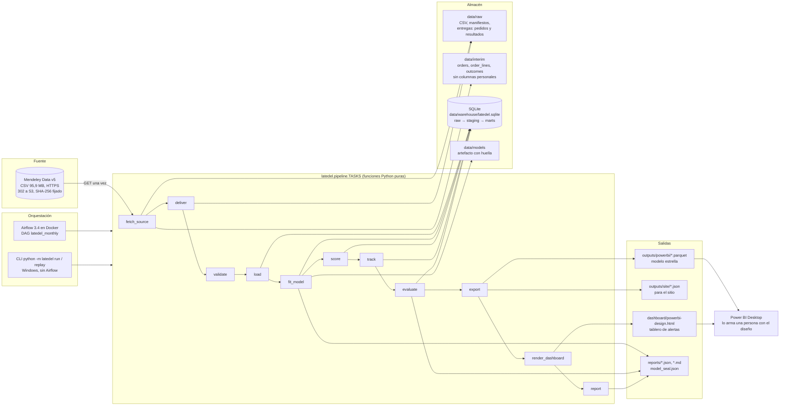

# Plan de implementación: pedidos que van a llegar tarde, antes de que lleguen

Fecha: 2026-11-10. Lee primero `requirements.md` (RF, RNF, AC y los criterios C01-C10) y `decisions.md` (D01-D36). Este plan dice cómo construirlo; si un detalle no está aquí ni allí, la decisión vuelve a quien planifica: no se adivina. Las suposiciones se marcan como **[Supuesto]** y lo que hay que comprobar antes de escribir código, como **[Verificar]**.

Convenciones: documentación en español neutro; código, identificadores, tablas y columnas en inglés; medidas DAX, títulos de visuales y textos del sitio en español. Comandos para Windows (PowerShell) y el `.venv` del proyecto; rutas relativas a `03-Logistics-Late-Deliveries/`. La estructura repite la de los proyectos 01 y 02: cuando este plan dice «como el proyecto 02», el código de referencia es el de `02-Ecommerce-Customer-Segmentation/`, que se adapta, no se importa. El paquete se llama `latedel`.

## 1. Arquitectura



Principios (los de los proyectos 01 y 02, más los de sus evaluaciones):

- Cada tarea es una función `fn(ctx: RunContext) -> dict` sin dependencias de Airflow. El DAG y la CLI recorren la misma tupla `TASKS`.
- Las tareas se pasan estado por archivos y tablas, nunca por XCom grandes: `data/interim/runs/<run_key>.json` guarda lo que produjo cada tarea.
- SQLite tiene un solo escritor (`max_active_runs=1`, `max_active_tasks=1`).
- Toda salida versionada se escribe a un temporal y se renombra con `os.replace`.
- **Dos flujos que no se tocan**: lo que se sabe al crear el pedido (`orders`, `order_lines`) y lo que se sabe después (`outcomes`) viven en archivos y tablas separados. Las variables solo leen el primero; las etiquetas solo existen en el almacén desde la fecha en que se conocen (D06, D09).
- Todo lo que se calcula en una fecha de cálculo (`as_of`) recibe esa fecha y filtra por ella: ningún cálculo lee «lo último que hay en el almacén» (RNF06).
- Las columnas personales se descartan en la lectura: no hay un lugar del proyecto donde puedan aparecer después (D07).
- Toda ruta relativa de la configuración y de la CLI se resuelve contra la carpeta del proyecto (D24).

## 2. Estructura de carpetas

```text
03-Logistics-Late-Deliveries/
  README.md
  pyproject.toml              # paquete latedel (src layout), pytest y marcas
  requirements.txt            # ejecución, fijadas con == (D28)
  requirements-dev.txt        # -r requirements.txt y pytest
  .gitignore                  # data/raw/, data/interim/, data/warehouse/, data/models/, data/quick/, airflow/logs/, airflow/config/, airflow/plugins/, airflow/.env, reports/validation/history/
  .dockerignore               # deja entrar solo requirements.txt al contexto de la imagen
  config/
    pipeline.toml             # configuración completa (sección 4)
    pipeline.quick.toml       # modo rápido: extends = "pipeline.toml", todo bajo data/quick/
  sql/
    schema/001_core.sql       # raw_*, deliveries, pipeline_runs, validation_results, stg_*
    schema/002_model.sql      # model_registry, baseline_rates, model_scores, tracking_monthly, eval_*
    staging/stg_orders.sql  stg_order_lines.sql  stg_outcomes.sql
    marts/ops/                # mart_labelled_orders.sql, mart_main_line.sql
    marts/powerbi/            # dim_*.sql, fact_*.sql (corren en export)
    checks/load/  checks/model/   # chk_*.sql: cada consulta devuelve las filas que violan (0 filas = pasa)
  src/latedel/
    __init__.py  __main__.py  cli.py  config.py  pipeline.py  sysinfo.py
    schema.py  ingest.py  deliveries.py  validate.py  warehouse.py
    features.py  split.py  baselines.py  model.py  threshold.py  registry.py
    scoring.py  tracking.py  evaluation.py  leakage_demo.py  reporting.py
    export.py  site_export.py  figures.py  docs.py
    dashboard/__init__.py  dashboard/semantic_model.py  dashboard/render.py  dashboard/svg.py
  airflow/
    Dockerfile  docker-compose.yaml  .env.example
    dags/latedel_monthly.py
  dashboard/powerbi-design.html          # generado (versionado)
  outputs/powerbi/*.parquet              # generado (versionado, ≤ 25 MB cada uno)
  outputs/site/*.json                    # generado (versionado, ≤ 200 KB en total)
  reports/evaluation_summary.json|.md    # generado (versionado)
  reports/model_seal.json                # sello del lanzamiento y de la prueba (versionado; D17)
  reports/validation/latest.json|.md     # generado (versionado); el historial no
  docs/  research.md requirements.md plan.md decisions.md
         data-dictionary.md model-card.md runbook.md paso-a-paso.md review-advisories.md evaluation.md figures/*.png
  tests/
    conftest.py
    fixtures/make_fixture.py  fixtures/http_server.py  fixtures/hand_cases.py
    unit/  contract/  integration/  e2e/  docs/
  data/raw/  data/interim/  data/warehouse/  data/models/  data/quick/   # nunca versionados
```

Entorno (U01): `py -3.11 -m venv .venv`, `.venv\Scripts\python -m pip install -r requirements-dev.txt`, `pip check`. Versiones en D28. No se usa el Python global.

Marcas de pytest: `real_data` (CSV real en `data/raw/`), `docker`, `slow`. Por defecto: `-m "not real_data and not docker"`.

## 3. Flujo de datos

Quince corridas componen la historia completa (D09): el lanzamiento (`L2017-01-07`, fecha de cálculo 2017-01-07), trece mensuales (`M2017-01` a `M2018-01`, con fechas de cálculo en el último día de cada mes) y el cierre (`C2018-02`, fecha de cálculo 2018-02-07, solo resultados). Una decimosexta termina como `no_delivery`.

| Entrega | Pedidos creados | Resultados conocidos | Qué pasa |
| --- | --- | --- | --- |
| `L2017-01-07` | 2015-01-01 a 2017-01-07 | hasta 2017-01-07 | Entrena, elige, calibra, fija el umbral y sella el lanzamiento; no puntúa |
| `M2017-01` | 2017-01-08 a 2017-01-31 | 2017-01-08 a 2017-01-31 | Puntúa los pedidos nuevos; sigue las alertas cerradas |
| `M2017-02` … `M2017-09` | el mes | el mes | Igual |
| `M2017-10` | el mes | el mes | Igual, y evalúa la prueba (fecha de cálculo ≥ 2017-10-07) y la sella |
| `M2017-11` … `M2018-01` | el mes | el mes | Igual; la prueba ya está sellada y no se recalcula |
| `C2018-02` | ninguno | 2018-02-01 a 2018-02-07 | Cierra los últimos resultados y evalúa el tramo posterior al cambio de forma (C10) |

1. `fetch_source`: si falta el CSV, lo descarga (HTTPS en cada salto, hosts permitidos, tope de redirecciones y de bytes, SHA-256 al vuelo, `.part`, `os.replace` solo si la huella es la aceptada). Si faltan los Parquet de `data/interim/` o su huella de origen no es la del CSV, lee el archivo con el contrato (V03-V05), comprueba el enmascarado (V06), las claves y la coherencia de cada pedido (V07), la definición de la etiqueta (V08) y el plazo de los resultados (V09), descarta las columnas personales y escribe `orders.parquet`, `order_lines.parquet` y `outcomes.parquet`, con el reporte de la fuente. Si ya están, no hace nada.
2. `deliver`: lee el manifiesto y publica la siguiente entrega pendiente en `data/raw/deliveries/<delivery_id>/` (`orders.parquet`, `order_lines.parquet`, `outcomes.parquet`), con su período, filas y SHA-256. Sin pendientes: registra la corrida `no_delivery`, reescribe `dim_pipeline_run.parquet` y el HTML si existen y corta el flujo.
3. `validate`: reglas V20-V24 e I01, I03 y I05 sobre la entrega y lo ya cargado; reporte. Con bloqueantes: cuarentena, corrida `rejected`, `ValidationError`.
4. `load`: en una transacción, agrega pedidos, líneas y resultados a `raw_*`, reconstruye `stg_*` hasta `as_of` y los marts operativos, y corre `sql/checks/load/`. Abre la fila de `pipeline_runs` como `running`.
5. `fit_model`: en el lanzamiento, ajusta los 24 candidatos en el entrenamiento, elige en V1, aplica la trampa de fuga (M01), calibra en V1, elige el umbral en V2, calcula la sensibilidad, las tasas de las líneas base, la demostración de fuga y la importancia, guarda el artefacto con su huella, lo registra y escribe la parte del lanzamiento del sello. En las demás corridas, comprueba la huella del artefacto registrado (M03) y que la configuración sea la del sello (M05); no reentrena.
6. `score`: puntúa una vez cada pedido nuevo de la entrega (M02, M04) → `model_scores` (solo inserción). El lanzamiento y el cierre no tienen pedidos nuevos.
7. `track`: con los resultados conocidos hasta `as_of`, recalcula `tracking_monthly` (por mes del pedido y modo) e I02 e I04.
8. `evaluate`: métricas de V2 desde el lanzamiento; si `as_of ≥ test_end + purge_days` y la prueba no está evaluada, evalúa la prueba, calcula C01-C09 y escribe la parte de la prueba del sello (o comprueba que reproduce la sellada, sección 13); si `as_of ≥ post_break_end + purge_days`, evalúa el tramo posterior (C10).
9. `export`: reconstruye los marts de Power BI, corre `sql/checks/model/` y exporta el modelo estrella y los JSON del sitio (la corrida sigue `running` en la tabla exportada).
10. `render_dashboard`: HTML del diseño desde la especificación y los Parquet.
11. `report`: escribe `reports/evaluation_summary.*` y `reports/validation/latest.*` y cierra la corrida en este orden: SQLite `ok`, `dim_pipeline_run.parquet` reescrita sola, `outputs/site/summary.json` reescrito solo, el HTML, y recién entonces la entrega queda `loaded` en el manifiesto (el orden del proyecto 02, D35).

## 4. Configuración

`config/pipeline.toml`, leído con `tomllib`, con dataclasses congeladas y comprobación clave por clave como el proyecto 02: una sección o clave desconocida, una faltante, un tipo equivocado o un par desordenado son `ValueError` con el nombre de la clave. `LATEDEL_CONFIG` elige otro archivo; `LATEDEL_HOME`, la carpeta del proyecto (D24).

```toml
[source]
mode = "http"                        # "http" o "local"
url = "https://data.mendeley.com/public-files/datasets/8gx2fvg2k6/files/72784be5-36d3-44fe-b75d-0edbf1999f65/file_downloaded"
allowed_hosts = ["data.mendeley.com", ".amazonaws.com"]   # nombre exacto, o sufijo si empieza con punto (V02)
max_redirects = 3
local_path = ""                      # modo local: ruta del CSV (relativa a la carpeta del proyecto)
accepted_sha256 = "fa6d022ed437155e1a2f0378710602848703c8a7f203f7ff5d77805bf8480aa6"   # modo http (V01); vacío en modo local
file_name = "DataCoSupplyChainDataset.csv"
encoding = "cp1252"
max_bytes = 134217728                # 128 MiB (V02)
chunk_bytes = 1048576
timeout_s = 120

[deliveries]
first_order_date = 2015-01-01
launch_date = 2017-01-07             # fin de la carga del lanzamiento
last_order_date = 2018-01-31
close_date = 2018-02-07              # último día de resultados

[split]                              # D08
train_start = 2015-01-01
train_end = 2016-06-30
purge_days = 7
valid_start = 2016-07-08
valid_v2_start = 2016-10-01          # V1 = [valid_start, valid_v2_start); V2 = [valid_v2_start, valid_end]
valid_end = 2016-12-31
test_start = 2017-01-08
test_end = 2017-09-30
post_break_start = 2017-10-01
post_break_end = 2018-01-31

[features]
candidate_sets = ["f0", "f1", "f2"]  # nombres; las columnas de cada uno están en features.py (D11)
noon_hour = 12                       # franja de B5 (D15)

[model]                              # D12
learning_rate = [0.05, 0.1]
max_leaf_nodes = [15, 31]
min_samples_leaf = [20, 100]
l2_regularization = 1.0
max_iter = 300
random_state = 0
calibration = "isotonic"
model_version = "v1"

[costs]                              # supuestos declarados, en unidades de costo genéricas (D14)
alert_cost = 5.0
late_cost = 20.0
effect = 0.5
threshold_min = 0.01
threshold_max = 0.99
threshold_step = 0.01
sensitivity_min = 0.10
sensitivity_max = 0.90
sensitivity_step = 0.05

[evaluation]
bootstrap_resamples = 1000
bootstrap_seed = 0
calibration_bins = 10
roc_points = 200
importance_repeats = 5

[criteria]                           # preregistrados (requirements.md 8.1, D16)
c06_max_ece = 0.03
c06_max_bias = 0.02
leak_tripwire_auc = 0.95             # M01 (D36)

[site]
max_total_bytes = 204800
min_cell_orders = 20

[paths]
raw_dir = "data/raw"
interim_dir = "data/interim"
warehouse = "data/warehouse/latedel.sqlite"
models_dir = "data/models"
outputs_dir = "outputs/powerbi"
site_dir = "outputs/site"
reports_dir = "reports"
seal = "reports/model_seal.json"
dashboard_html = "dashboard/powerbi-design.html"
readme = "README.md"
figures_dir = "docs/figures"
```

`config/pipeline.quick.toml`: `extends = "pipeline.toml"`; `[source] mode = "local"`, `local_path = "data/quick/dataco_fixture.csv"`, `accepted_sha256 = ""`; `[model]` con una sola configuración (`learning_rate = [0.1]`, `max_leaf_nodes = [15]`, `min_samples_leaf = [20]`); `[evaluation] bootstrap_resamples = 200`; `[paths]` todas bajo `data/quick/`, incluidos `seal = "data/quick/reports/model_seal.json"`, `readme = "data/quick/README.md"` y `figures_dir = "data/quick/figures"`. El accesorio cubre el mismo calendario que la fuente, así que las fechas no cambian. `_check` rechaza `mode = "local"` con `local_path` vacío; `mode = "http"` con `accepted_sha256` vacío, con una URL que no sea `https://` o con un host de la URL fuera de `allowed_hosts`; una grilla vacía; costos ≤ 0 o `effect` fuera de (0, 1]; fechas de la partición fuera de orden o con una purga distinta de `purge_days`.

## 5. Almacenamiento

SQLite con archivos SQL en capas `raw → stg → marts` y controles en SQL (D20). Reglas del runner (`warehouse.py`), las de los proyectos 01 y 02: `connect()` en modo autocommit con `journal_mode=DELETE`, `synchronous=FULL`, `foreign_keys=ON`; transacciones explícitas `BEGIN IMMEDIATE`; **nunca** `executescript()` (hace un `COMMIT` implícito); sentencias partidas con `sqlite3.complete_statement`; marts con `DROP TABLE IF EXISTS` + `CREATE TABLE AS` dentro de la transacción; parámetros con nombre (`:as_of`).

`sql/schema/001_core.sql` (clave primaria entre paréntesis):

- `raw_orders` (`order_id`): `delivery_id`, `order_ts` (ISO sin zona), `order_date`, `regime`, `shipping_mode`, `scheduled_days`, `payment_type`, `market`, `order_region`, `order_country`, `customer_segment`, `customer_country`.
- `raw_order_lines` (`line_id`): `order_id`, `delivery_id`, `department_name`, `category_name`, `product_card_id`, `product_name` (sin espacios finales), `quantity`, `product_price`, `sales`, `discount`, `discount_rate`, `item_total`.
- `raw_outcomes` (`order_id`): `delivery_id`, `outcome_known_date`, `delivery_status`, `order_status`, `real_days`, `shipping_ts`, `source_label`, `is_cancelled`, `benefit_total`, `profit_ratio_mean`.
- `deliveries` (`delivery_id`): `kind` (`launch`, `monthly`, `close`), `orders_from`, `orders_to`, `outcomes_from`, `outcomes_to`, `as_of_date`, `orders`, `lines`, `outcomes`, `sha256_json`, `status` (`published`, `loaded`, `rejected`), `run_key`.
- `pipeline_runs` (`run_key`): `started_at`, `finished_at`, `status` (`running`, `ok`, `failed`, `rejected`, `no_delivery`), `delivery_id`, `as_of_date`, `source_sha256`, `orders_delivery`, `outcomes_delivery`, `orders_scored`, `alerts`, `peak_working_set_mb`, `peak_commit_mb` (nulo fuera de Windows), `message`.
- `validation_results` (`run_key`, `rule_id`): `name_es`, `severity`, `scope`, `passed`, `rows_affected`, `orders_affected`, `examples_json` (nunca con columnas personales: no existen a esta altura).
- `stg_orders`, `stg_order_lines` (las de `raw_*` con tipos, hasta `:as_of` por `order_date`) y `stg_outcomes` (las de `raw_outcomes` con `outcome_known_date <= :as_of`, más `is_late`).

`sql/schema/002_model.sql`:

- `model_registry` (`model_version`): `trained_as_of`, `artifact_path`, `artifact_sha256`, `feature_set`, `params_json`, `calibration`, `threshold`, `costs_json`, `config_sha256`, `selection_json` (pérdida logarítmica de cada candidato en V1), `valid_v2_json`.
- `baseline_rates` (`baseline`, `cell`): `rate`, `train_orders`.
- `model_scores` (`order_id`): `as_of_date`, `run_key`, `model_version`, `risk`, `threshold`, `is_alert`. **Solo inserción**: tres disparadores (`BEFORE UPDATE`, `BEFORE DELETE` y un `BEFORE INSERT` que rechaza un `order_id` ya puntuado) abortan con `RAISE(ABORT, 'model_scores is insert-only')`. El tercero existe porque `INSERT OR REPLACE` y `REPLACE` borran la fila sin ejecutar el disparador de borrado mientras `recursive_triggers` está apagado, como encontró el proyecto 02 con su grupo de control (su D44).
- `tracking_monthly` (`as_of_date`, `order_month`, `shipping_mode`): `orders_scored`, `alerts`, `closed_orders`, `closed_alerts`, `alerts_late`, `late_closed`, `late_missed`, `late_expected`, `cancelled_orders`, `alerts_on_cancelled`.
- `eval_metrics` (`scope`, `method`, `metric`, `seal_state`): `value`. `scope` en `valid_v2`, `test`, `post_break`; `seal_state` en `sealed`, `post_seal`.
- `eval_bootstrap` (`comparison`, `seal_state`): `diff`, `ci_low`, `ci_high`, `resamples`, `seed`.
- `eval_criteria` (`criterion_id`, `seal_state`): `value`, `baseline_value`, `threshold_es`, `passed`, `verdict_es`.
- `eval_sensitivity` (`break_even`, `method`, `seal_state`): `threshold`, `nb_total`, `nb_per_1000`, `flagged_share`.
- `eval_roc`, `eval_calibration`, `eval_leakage`, `feature_importance`.

`model_registry` y `model_scores` no se reemplazan nunca; `tracking_monthly` y `eval_*` de una fecha se reemplazan al repetir esa fecha, salvo las filas `sealed` de la prueba, que se escriben una vez (sección 13).

## 6. Contrato del archivo, entregas y validación

`schema.py` es la única fuente de las listas de columnas (D06, D07):

- `SOURCE_COLUMNS`: las 53 del encabezado, en orden (research.md).
- `PERSONAL_COLUMNS` (15): `Customer Email`, `Customer Password`, `Customer Fname`, `Customer Lname`, `Customer Street`, `Customer Zipcode`, `Customer City`, `Customer State`, `Customer Id`, `Order Customer Id`, `Order City`, `Order State`, `Order Zipcode`, `Latitude`, `Longitude`.
- `LEAKING_COLUMNS` (8): `Late_delivery_risk` (objetivo), `Delivery Status`, `Days for shipping (real)`, `shipping date (DateOrders)`, `Order Status` (posteriores al pedido) y `Benefit per order`, `Order Profit Per Order`, `Order Item Profit Ratio` (momento no establecido; por precaución). Van solo al flujo de resultados.
- `DUPLICATE_OR_CONSTANT_COLUMNS`: `Sales per customer` (= `Order Item Total`), `Order Item Product Price` (= `Product Price`), `Product Card Id` (= `Order Item Cardprod Id`), `Product Category Id` (= `Category Id`), `Product Status` (constante), `Product Description` (vacía), `Product Image` (URL).
- `ORDER_LEVEL_COLUMNS`: las 20 que la sección 4 de los requerimientos midió constantes dentro del pedido; V07 lo comprueba.
- `ORDER_TIME_COLUMNS`: la lista permitida de lo que pasa a `orders` y `order_lines`. Una prueba comprueba que las cuatro listas cubren las 53 columnas sin solaparse.

`read_source(path, cfg) -> SourceFrames` lee con `open(path, encoding="cp1252", errors="strict", newline="")` y el módulo `csv` (o `pandas.read_csv` con `encoding_errors="strict"` y `dtype=str` **[Verificar en U03 cuál detecta la fila corta sin tolerarla]**), comprueba primero el encabezado y la cantidad de campos, convierte los tipos con formato fijo y devuelve los tres marcos ya sin las columnas personales.

Reglas. Las de la fuente corren en `fetch_source`, una vez por huella; las de la entrega, en `validate`; las del modelo, donde se indica. Cifras de referencia de la fuente real entre paréntesis.

| ID | Severidad | Alcance | Regla | Acción |
| --- | --- | --- | --- | --- |
| V01 | bloqueante | fuente | El CSV tiene la huella aceptada (o la registrada, en modo local) | Rechazo; nada cambia |
| V02 | bloqueante | fuente | Descarga segura: HTTPS en cada salto, host permitido, ≤ 3 redirecciones, ≤ `max_bytes` | Corte antes del archivo final |
| V03 | bloqueante | fuente | cp1252 estricto, sin bytes nulos ni BOM, saltos CRLF o LF | Rechazo |
| V04 | bloqueante | fuente | Encabezado con las 53 columnas exactas, en orden | Rechazo |
| V05 | bloqueante | fuente | Cada fila con 53 campos; fechas `%m/%d/%Y %H:%M`, enteros y decimales convertibles (0 fallas) | Rechazo |
| V06 | bloqueante | fuente | `Customer Email` y `Customer Password` valen `XXXXXXXXX` en todas las filas | Rechazo: no se procesa una fuente con datos sin enmascarar |
| V07 | bloqueante | fuente | `Order Item Id` única; cada pedido con un solo valor en cada columna de `ORDER_LEVEL_COLUMNS` (0 pedidos) | Rechazo |
| V08 | bloqueante | fuente | En los pedidos no cancelados, `Late_delivery_risk = 1` si y solo si días reales > programados (0 discrepancias) | Rechazo: la etiqueta cambió de significado |
| V09 | bloqueante | fuente | `outcome_known_date − order_date ≤ purge_days − 1` (máximo medido: 6) | Rechazo: la purga dejaría de alcanzar |
| V10 | advertencia | fuente | Días programados según el modo (Same Day 0, First 1, Second 2, Standard 4) | Se cuenta |
| V11 | advertencia | fuente | Pedidos cancelados (2.855 pedidos, 7.754 líneas) | Fuera de la tarea; se puntúan si son nuevos (D05) |
| V12 | advertencia | fuente | Columnas repetidas idénticas (6 pares, 0 discrepancias) | Se usa una copia; se cuentan las discrepancias |
| V13 | advertencia | fuente | `Sales` = precio × cantidad y `Order Item Total` = `Sales` − descuento (0 discrepancias) | Se cuenta |
| V14 | advertencia | fuente | Espacios finales en `Product Name` (0,98 % de las líneas) | Se recortan |
| V15 | informativa | fuente | Columnas personales descartadas en la lectura (15) | Solo cuenta |
| V16 | informativa | fuente | Columnas constantes, vacías o repetidas fuera del modelo (7) | Solo cuenta |
| V17 | informativa | fuente | Cambio de forma: líneas por pedido por mes; desde 2017-10, `post_break` (8.403 pedidos) | Solo cuenta y marca |
| V18 | informativa | fuente | Columnas apartadas al flujo de resultados (8) | Solo cuenta |
| V20 | bloqueante | entrega | La entrega es la siguiente del plan y sus períodos empiezan el día siguiente al fin de los de la anterior | Rechazo |
| V21 | bloqueante | entrega | Cada pedido con su fecha dentro del período de pedidos; cada resultado, con su fecha de conocimiento dentro del de resultados | Rechazo |
| V22 | bloqueante | entrega | Ningún pedido, línea ni resultado ya cargado | Rechazo |
| V23 | bloqueante | entrega | Cada resultado y cada línea corresponden a un pedido cargado o de la misma entrega | Rechazo |
| V24 | bloqueante | entrega | La entrega no está vacía (el cierre puede no traer pedidos) y sus filas y SHA-256 son los del manifiesto | Rechazo |
| M01 | bloqueante | modelo | Trampa de fuga: AUC del candidato elegido en V1 < `leak_tripwire_auc` (0,95) | Detiene el lanzamiento: «posible fuga» (D36) |
| M02 | bloqueante | modelo | Las columnas de la matriz son exactamente las del conjunto elegido y ninguna está en `LEAKING_COLUMNS` ni en `PERSONAL_COLUMNS` | Falla la tarea |
| M03 | bloqueante | modelo | El artefacto tiene la huella registrada (se comprueba antes de deserializarlo) | Falla la tarea (D30) |
| M04 | bloqueante | modelo | Una probabilidad finita en [0, 1] por pedido nuevo | Falla la tarea |
| M05 | advertencia | modelo | La configuración es distinta de la sellada | El resultado se guarda como `post_seal` y no reemplaza el sellado (D17) |
| I01 | informativa | entrega | Pedidos nuevos en la entrega | Solo cuenta |
| I02 | informativa | modelo | Alertas emitidas y % alertado | Solo cuenta |
| I03 | informativa | entrega | Resultados que llegaron en la entrega | Solo cuenta |
| I04 | informativa | modelo | Alertas sobre pedidos que después se cancelaron | Solo cuenta (D05) |
| I05 | informativa | entrega | Pedidos del tramo posterior al cambio de forma | Solo cuenta |

`ValidationReport` como el del proyecto 02 (con `not_evaluated` y hasta 5 ejemplos por regla, que solo pueden traer `order_id`, `line_id` y columnas de `ORDER_TIME_COLUMNS` o de resultados), con `orders_affected` en vez de libras.

Entregas (`deliveries.py`): el plan es la lista fija `L2017-01-07`, `M2017-01` … `M2018-01` y `C2018-02` (sección 3); un pedido va en la entrega de su `order_date`; un resultado, en la de su `outcome_known_date`. El manifiesto `data/raw/deliveries/manifest.json` tiene el formato con versión de los proyectos 01 y 02 (`{"version": 1, "entries": [...]}`), escrito a un temporal y renombrado.

## 7. SQL

- `sql/staging/stg_orders.sql`: desde `raw_orders` con `order_date <= :as_of`; tipos. No tiene ninguna columna de resultado: una prueba estática lo comprueba (AC13).
- `stg_order_lines.sql`: desde `raw_order_lines` de los pedidos de `stg_orders`.
- `stg_outcomes.sql`: desde `raw_outcomes` con `outcome_known_date <= :as_of`; `is_late = CASE WHEN is_cancelled THEN NULL ELSE real_days > scheduled_days END` (con el join a `raw_orders` para los días programados).
- `sql/marts/ops/mart_main_line.sql`: la línea principal de cada pedido (mayor `sales`; empate, menor `line_id`).
- `mart_labelled_orders.sql`: pedidos de `stg_orders` con resultado en `stg_outcomes`, no cancelados, con `is_late` y el bloque de la partición (sección 9). Es la única fuente de etiquetas del modelo; `features.py` no la lee.
- `sql/checks/load/`: `chk_raw_order_unique`, `chk_line_has_order`, `chk_outcome_has_order`, `chk_outcome_unique`, `chk_outcome_not_before_order`, `chk_outcome_lag_within_purge`, `chk_label_definition` (`source_label` = `is_late` en los no cancelados), `chk_one_mode_per_order`.
- `sql/marts/powerbi/` y `sql/checks/model/` (corren en `export`): `chk_one_score_per_order`, `chk_scores_range`, `chk_alert_matches_threshold` (`is_alert = risk >= threshold`), `chk_no_score_before_test_start`, `chk_fact_order_unique`, `chk_fk_*` (una por relación), `chk_tracking_totals` (la suma por mes y modo es la de `model_scores`).

## 8. Variables y fuga (`features.py`)

```python
FEATURE_SETS: dict[str, tuple[str, ...]]          # "f0", "f1", "f2" (D11)
CATEGORICAL: frozenset[str]
class LeakageError(RuntimeError): ...
def build_features(orders: pd.DataFrame, lines: pd.DataFrame, feature_set: str) -> pd.DataFrame
```

- **F0** (2): `shipping_mode`, `scheduled_days`.
- **F1** (18): F0 más `payment_type`, `market`, `order_region`, `order_country`, `customer_segment`, `customer_country`, `main_department`, `main_category`, `main_product`, `n_lines`, `n_departments`, `units` (Σ cantidad), `gross_sales` (Σ `Sales`), `item_total` (Σ `Order Item Total`), `discount` (Σ descuento), `max_discount_rate`. Es el conjunto de la primera mirada de research.md, llevado al pedido.
- **F2** (22): F1 más `order_hour` (0-23), `order_weekday` (0-6), `order_day` (1-31) y `order_month` (1-12), de `order_ts`.

Guardas (AC13, AC14):

- `build_features` recibe solo `orders` y `lines` (marcos de `stg_orders` y `stg_order_lines`) y lanza `LeakageError` si alguno trae una columna de `LEAKING_COLUMNS`, de `PERSONAL_COLUMNS`, un nombre interno de resultado (`is_late`, `real_days`, `shipping_ts`, `outcome_known_date`, `delivery_status`, `order_status`, `is_cancelled`, `benefit_total`, `profit_ratio_mean`, `source_label`) o cualquier columna fuera de `ORDER_TIME_COLUMNS`.
- La salida tiene una fila por `order_id` (índice) y exactamente las columnas de `FEATURE_SETS[feature_set]`, en ese orden; si no, `LeakageError` (M02).
- Una prueba estática recorre el código de `features.py`, `scoring.py` y `sql/staging/stg_orders.sql` y falla si nombran `stg_outcomes`, `raw_outcomes` o `mart_labelled_orders`.
- Perturbación (integración): con todas las columnas de resultado de todos los pedidos cambiadas (etiqueta invertida, días reales, estado de entrega, fecha de envío, estado del pedido, rentabilidad), cada variable de cada pedido es idéntica.
- No hay variables de historia del cliente ni tasas móviles de resultados (D11).

## 9. Partición en el tiempo (`split.py`)

- `block(order_date, cfg) -> str` devuelve `train`, `purge_1`, `valid_v1`, `valid_v2`, `purge_2`, `test` o `post_break` por la fecha del pedido, con los bordes de `[split]` (los de la tabla de la sección 4 de los requerimientos).
- La purga de 7 días sale de V09: un resultado se conoce a más tardar 6 días después del pedido, así que todas las etiquetas del entrenamiento se conocen antes del 2016-07-08 y todas las de la validación antes del lanzamiento (2017-01-07). Una prueba lo comprueba con `outcome_known_date` (AC15).
- `labelled_orders(conn, as_of, cfg) -> pd.DataFrame` lee `mart_labelled_orders` en `as_of`: en el lanzamiento trae entrenamiento y validación; la prueba no existe todavía en el almacén.
- V1 elige y calibra; V2 fija el umbral y da las cifras de validación; la prueba se toca una vez (D13, D17). El tramo posterior al cambio de forma no se usa para nada más que C10.

## 10. Líneas base (`baselines.py`)

Todas con tasas calculadas solo con el entrenamiento (`baseline_rates`), sobre los mismos bloques y la misma etiqueta:

| ID | Regla | Puntaje | Uso |
| --- | --- | --- | --- |
| B0 | Todo tarde | 1 | Referencia (marca el 100 %) |
| B1 | Solo First Class | 1 si First Class | Referencia (la más precisa) |
| B2 | Tasa de retraso del entrenamiento por modo | la tasa (First 1,000; Second 0,8017; Same Day 0,4652; Standard 0,4013); marca si ≥ 0,5 | La regla de la investigación y del sitio; C01, C02, C04, C07-C09 |
| B3 | Días programados ≤ 2 | 1 si ≤ 2 | Referencia |
| B4 | Control negativo: solo Standard Class | 1 si Standard | Debe quedar por debajo de la tasa base |
| B5 | Tasa del entrenamiento por modo × franja (antes o desde `noon_hour`) | la tasa de la celda (8 celdas) | La regla de dos variables; C03, C05 (D15) |

`fit_rates(train, by) -> RateTable` y `score(rate_table, orders) -> np.ndarray`; una celda sin pedidos en el entrenamiento toma la tasa del modo **[Supuesto: no pasa en los datos reales]**.

## 11. Modelo, selección y calibración (`model.py`)

```python
@dataclass(frozen=True)
class Candidate: feature_set: str; learning_rate: float; max_leaf_nodes: int; min_samples_leaf: int
def candidates(cfg: ModelConfig, sets: list[str]) -> list[Candidate]            # 3 × 8 = 24, en orden fijo
def make_pipeline(c: Candidate, cfg: ModelConfig) -> Pipeline
def select(fitted: list[tuple[Candidate, Pipeline]], X_v1, y_v1) -> Selection   # menor log-loss en V1
def calibrate(pipe: Pipeline, X_v1, y_v1, method: str) -> CalibratedClassifierCV
def predict_risk(model, X) -> np.ndarray
```

- `make_pipeline`: `ColumnTransformer` con `OrdinalEncoder(categories="auto", handle_unknown="use_encoded_value", unknown_value=np.nan, encoded_missing_value=np.nan)` para las categóricas (orden alfabético, fijado en el entrenamiento) y las numéricas tal cual, seguido de `HistGradientBoostingClassifier(learning_rate, max_leaf_nodes, min_samples_leaf, l2_regularization=1.0, max_iter=300, early_stopping=False, random_state=0, categorical_features=<máscara>)`. **[Verificar en U12]** que una categoría nueva en la prueba (un país que no estaba) se trata como faltante sin error, y que `OrdinalEncoder` con `unknown_value=np.nan` produce la máscara que espera el clasificador.
- `select`: el candidato con menor `log_loss` en V1 sin calibrar; en un empate a 1e-6, el más simple (F0 < F1 < F2, después menos hojas, más muestras por hoja y menor tasa de aprendizaje). Se guardan las 24 pérdidas (`selection_json`).
- M01: si el AUC del elegido en V1 es ≥ `leak_tripwire_auc`, `LeakageError` y el lanzamiento se detiene (runbook R5).
- `calibrate`: `CalibratedClassifierCV(FrozenEstimator(pipe), method="isotonic")` ajustado con V1 (`sklearn.frozen.FrozenEstimator`, presente en scikit-learn 1.9.1). El modelo en uso es el calibrado.
- Importancia: `permutation_importance` del modelo calibrado en V2, `scoring="roc_auc"`, `n_repeats = importance_repeats`, `random_state = 0` → `feature_importance`.
- Medido: un ajuste de 300 iteraciones sobre 29.894 pedidos tarda 0,72 s; los 24, unos 20 s.

## 12. Umbral por costo y sensibilidad (`threshold.py`)

```python
@dataclass(frozen=True)
class Costs: alert_cost: float; late_cost: float; effect: float
    def break_even(self) -> float: return self.alert_cost / (self.late_cost * self.effect)
def net_benefit(y: np.ndarray, flagged: np.ndarray, costs: Costs) -> float
def choose_threshold(p: np.ndarray, y: np.ndarray, costs: Costs, grid: np.ndarray) -> float
def sensitivity(scores_v2: dict[str, np.ndarray], y_v2, scores_test: dict[str, np.ndarray] | None, y_test, cfg) -> pd.DataFrame
```

- Beneficio neto de un pedido marcado: `is_late × late_cost × effect − alert_cost`; de uno no marcado, 0 (research.md, «Umbral por costo»).
- `choose_threshold` recorre la grilla de `threshold_min` a `threshold_max` de a `threshold_step`, marca `p ≥ t` y se queda con el mayor beneficio en V2; en un empate, el mayor `t`. Junto al umbral se guarda el punto de equilibrio teórico (`break_even`), que con probabilidades calibradas debería quedar cerca.
- Nunca F1: no se importa `f1_score` en `threshold.py` ni en `model.py` (una prueba estática), y una prueba con un accesorio donde F1 marcaría ≥ 95 % de los pedidos comprueba que el umbral por costo no lo hace (AC19).
- Sensibilidad: para cada punto de equilibrio `b` del rango (17 valores), se escala `alert_cost = b × late_cost × effect`, se elige el umbral en V2 para el modelo, B2 y B5, y en la prueba (solo cuando se evalúa) se calcula el beneficio por cada 1.000 pedidos y el % marcado de cada uno. Es parte del producto (página 4 del tablero, `algorithms.json`) y de C09.
- Costos por defecto: 5, 20 y 0,5 (punto de equilibrio 0,5; D14). Son supuestos: el README, la ficha, el tablero y el sitio lo dicen.

## 13. Lanzamiento congelado, puntuación y sello (`registry.py`, `scoring.py`)

```python
def save_artifact(model, path: Path) -> str                         # pickle (protocolo 5); devuelve el SHA-256 de los bytes
def load_artifact(path: Path, expected_sha256: str)                  # M03: lee los bytes una vez, compara su huella y recién entonces pickle.loads de esos mismos bytes
def config_fingerprint(cfg: PipelineConfig, selection: Selection, threshold: float) -> tuple[dict, str]
def seal_state(seal_path: Path, config_sha256: str) -> Literal["none", "match", "post_seal"]
def write_launch_seal(seal_path: Path, launch: dict) -> None         # una vez; si existe y coincide, no hace nada
def write_test_seal(seal_path: Path, test: dict) -> None             # una vez
def score_new_orders(conn, delivery_id: str, model, threshold: float, run_meta: RunMeta) -> ScoreResult
```

- El artefacto va a `data/models/<model_version>.pkl` (no versionado), escrito con `pickle` de la biblioteca estándar, y su SHA-256 a `model_registry`. Cargarlo exige la huella: un archivo cambiado no se deserializa, y como la huella se calcula sobre los mismos bytes que se deserializan, no hay una ventana entre comprobar y cargar (D30, runbook R6).
- **Sello** (`reports/model_seal.json`, versionado; D17):

  ```json
  {
    "version": 1,
    "launch": {
      "run_key": "...", "as_of": "2017-01-07", "source_sha256": "fa6d...0aa6",
      "model_version": "v1", "feature_set": "<f0|f1|f2, el elegido en V1>",
      "params": {"learning_rate": "<elegido>", "max_leaf_nodes": "<elegido>", "min_samples_leaf": "<elegido>", "l2_regularization": 1.0, "max_iter": 300},
      "calibration": "isotonic", "threshold": "<elegido en V2>",
      "costs": {"alert_cost": 5.0, "late_cost": 20.0, "effect": 0.5},
      "split": {"...": "las fechas de [split]"}, "criteria": {"...": "las claves de [criteria]"},
      "valid_v2_scores_sha256": "...",
      "config_sha256": "..."
    },
    "test": {
      "run_key": "...", "as_of": "2017-10-31", "config_sha256": "...",
      "criteria": [{"id": "C01", "value": 0.0, "baseline_value": 0.0, "ci_low": null, "ci_high": null, "passed": true}],
      "metrics": {"model": {"auc": 0.0, "...": 0.0}, "b2_mode": {}, "b5_mode_noon": {}}
    }
  }
  ```

  (los valores son de forma, no resultados). `config_sha256` es el SHA-256 del JSON canónico (`sort_keys=True`, separadores fijos) de todo `launch` salvo `run_key`, `valid_v2_scores_sha256` y el propio `config_sha256`; `valid_v2_scores_sha256`, el de los riesgos de V2 redondeados a 6 decimales y ordenados por `order_id`.
- Reglas del sello: el lanzamiento escribe `launch` si no hay sello; si lo hay con el mismo `config_sha256`, comprueba `valid_v2_scores_sha256` (distinto: la tarea falla, runbook R7); si lo hay con otro, la corrida sigue y todo lo que calcule es `post_seal` (M05). La primera evaluación de la prueba con la configuración sellada escribe `test`; una repetición desde cero con la misma configuración compara sus valores redondeados a 6 decimales con los sellados (distintos: la tarea falla, R7); con otra configuración, sus valores se guardan como `post_seal` en `eval_*` y el resumen los muestra aparte, debajo de los sellados. Ninguna parte del sello se reescribe. Borrar el sello es empezar un análisis nuevo y se registra en `decisions.md` (runbook R13).
- `score_new_orders`: arma las variables de los pedidos de la entrega con `build_features`, comprueba M02 y M04, inserta en `model_scores` una fila por pedido (`risk`, `threshold`, `is_alert = risk >= threshold`, `model_version`, `as_of_date`, `run_key`). Un pedido ya puntuado no se vuelve a puntuar (los disparadores lo impiden). Es la función que envolvería una API (D33).

## 14. Evaluación, criterios y resumen (`evaluation.py`, `reporting.py`, `leakage_demo.py`)

Cohorte, ventanas y definiciones: `requirements.md`, sección 8.1.

- `evaluate_block(conn, block, cfg) -> EvaluationResult`: para el modelo (`model_scores` del bloque), B2 y B5 (puntajes de `baseline_rates`) y B0-B4 (reglas), con las etiquetas de `mart_labelled_orders` en `as_of`: AUC, PR-AUC (`average_precision_score`), Brier, ECE, sesgo (media de p − tasa), umbral, % marcado, precisión, recall, beneficio total y por 1.000 pedidos; la curva ROC reducida a `roc_points` puntos por método; la calibración por intervalo; C08 con k = los marcados por B2 a 0,5 (empates del modelo por `order_ts` y después `order_id`).
- En V2 los puntajes del modelo salen de predecir con el artefacto (V2 no se puntúa en `model_scores`, que es solo para pedidos nuevos).
- `paired_bootstrap(y, s_a, s_b, n, seed) -> Bootstrap`: `rng = np.random.default_rng(seed)`; en cada remuestra, los mismos índices para los dos puntajes; `diff = AUC(s_a) − AUC(s_b)`; percentiles 2,5 y 97,5; una remuestra con una sola clase se descarta y se cuenta (D18).
- `evaluate_criteria(result, cfg) -> list[Criterion]` con `criterion_id`, `value`, `baseline_value`, `ci_low`, `ci_high`, `threshold_es`, `passed`, `seen_by_research`, `seen_by_planner` y `verdict_es` de plantillas fijas, por ejemplo «El modelo supera a la regla por modo: AUC 0,77 frente a 0,74.» o «El modelo no supera a la regla de dos variables: la diferencia de AUC es 0,001, con un intervalo del 95 % de −0,004 a 0,006.». C10 no tiene `passed`. Un criterio que no se puede calcular (por ejemplo, una métrica con una sola clase) queda `passed = false` con el motivo, nunca aprobado (lección D47 del proyecto 02).
- `leakage_table(conn, cfg) -> pd.DataFrame` (en el lanzamiento): para cada columna de `LEAKING_COLUMNS` salvo el objetivo, el AUC en V2 de un `HistGradientBoostingClassifier` entrenado en el entrenamiento con el modo de envío y esa columna (la fecha de envío como horas desde el pedido); y la referencia, solo el modo. Vive en su propio módulo, lee `mart_labelled_orders` y `stg_outcomes` a propósito, y una prueba comprueba que no puede escribir en `model_registry` ni en `model_scores` (D31).
- `write_summary(...)` escribe `reports/evaluation_summary.{json,md}`; `docs-sync` copia el Markdown entre `<!-- results:start -->` y `<!-- results:end -->` del README; una prueba compara (AC23).
- Antes de la evaluación de la prueba, el resumen dice «La prueba se evalúa con la entrega de 2017-10» y los criterios quedan `pending`; las cifras de V2 sí se muestran, rotuladas como validación.

## 15. Seguimiento mensual (`tracking.py`)

`tracking_at(conn, as_of) -> pd.DataFrame`, por mes del pedido y modo, sobre los pedidos de `model_scores`: puntuados, alertas, cerrados (con resultado conocido en `as_of`), alertas cerradas, alertas que llegaron tarde, tarde cerrados, tarde sin alerta, retrasos esperados (Σ `risk` de los cerrados), cancelados y alertas sobre cancelados (I04). Es lo que vería un equipo de logística mes a mes; no cambia el modelo ni el umbral (D17). La precisión y el recall del mes se calculan en el tablero y en `alerts.json` a partir de esos conteos.

## 16. Salidas: modelo estrella

Parquet en `outputs/powerbi/`, uno por tabla, con esquema Arrow tomado de la especificación y metadatos `latedel.run_key`, `latedel.as_of`, `latedel.source_sha256`, `latedel.attribution` (D21). Ninguna tabla tiene columnas personales (no existen después de la lectura).

Dimensiones (clave en negrita):

| Tabla | Columnas |
| --- | --- |
| `dim_date` | **`date_key`** int32 (AAAAMMDD), `date` date, `year`, `month`, `month_key` int32, `month_name_es`, `weekday` int32, `weekday_es`, `block_es`, `is_test` bool |
| `dim_month` | **`month_key`** int32 (AAAAMM), `month_start` date, `year_month_label`, `block_es`, `regime` |
| `dim_shipping_mode` | **`mode_key`** string, `mode_es`, `scheduled_days` int32, `train_late_rate` double, `sort_order` int32 |
| `dim_geo` | **`geo_key`** int32, `market`, `order_region`, `order_country` |
| `dim_product` | **`product_key`** int32 (código del producto), `product_name`, `category_name`, `department_name` |
| `dim_segment` | **`segment_key`** string, `segment_es` |
| `dim_payment` | **`payment_key`** string, `payment_es` |
| `dim_model` | **`model_version`** string, `feature_set`, `params_es`, `calibration`, `threshold`, `alert_cost`, `late_cost`, `effect`, `break_even`, `trained_as_of` date, `config_sha256`, `seal_state` |
| `dim_pipeline_run` | **`run_key`** y las columnas de `pipeline_runs`, con `as_of_key` |
| `dim_as_of` | **`as_of_key`** int32, `as_of_date` date, `as_of_label` (tabla de parámetro, sin relaciones: elige la fecha de cálculo en las medidas) |

Hechos:

| Tabla | Grano | Columnas |
| --- | --- | --- |
| `fact_order` | pedido | `order_id` int64, `order_date_key`, `mode_key`, `geo_key`, `main_product_key`, `segment_key`, `payment_key`, `order_ts`, `order_hour`, `order_weekday`, `n_lines`, `units`, `gross_sales`, `item_total`, `discount`, `block`, `regime`, `outcome_status` (`open`, `closed`, `cancelled`), `outcome_known_date`, `real_days`, `is_late`, `risk`, `is_alert`, `threshold`, `scored_as_of_date`, `model_version`, `run_key` (65.752 filas; las de puntaje y resultado, nulas donde no hay) |
| `fact_tracking_monthly` | mes del pedido × modo | `month_key`, `mode_key`, `orders_scored`, `alerts`, `closed_orders`, `closed_alerts`, `alerts_late`, `late_closed`, `late_missed`, `late_expected`, `cancelled_orders`, `alerts_on_cancelled` |
| `fact_method_metrics` | alcance × método | `scope` (`valid_v2`, `test`, `post_break`), `method`, `label_es`, `auc`, `pr_auc`, `brier`, `ece`, `threshold`, `flagged_share`, `precision`, `recall`, `nb_total`, `nb_per_1000`, `seal_state` |
| `fact_evaluation_summary` | criterio | `criterion_id`, `name_es`, `value`, `baseline_value`, `ci_low`, `ci_high`, `threshold_es`, `passed`, `seen_by_research`, `seen_by_planner`, `verdict_es`, `seal_state` |
| `fact_roc` | método × punto | `scope`, `method`, `point`, `fpr`, `tpr` |
| `fact_calibration` | método × intervalo | `scope`, `method`, `bin`, `p_mean`, `observed`, `orders` |
| `fact_cost_sensitivity` | punto de equilibrio × método | `break_even`, `method`, `threshold`, `nb_per_1000`, `flagged_share`, `seal_state` |
| `fact_leakage` | columna | `column`, `column_es`, `kind`, `known_at_es`, `auc_with_mode_valid`, `note_es` |
| `fact_importance` | variable | `feature`, `feature_es`, `auc_drop` |
| `fact_validation` | corrida × regla | `run_key`, `rule_id`, `name_es`, `severity` (`bloqueante`, `advertencia`, `informativa`), `scope`, `status` (`pasa`, `falla`, `advierte`), `rows_affected`, `orders_affected` |

Relaciones: uno a varios, filtro unidireccional de la dimensión al hecho, todas activas. `dim_as_of`, `dim_model` y los hechos de evaluación no tienen relaciones (alimentan sus propios visuales y medidas).

| ID | Dimensión (1) | Hecho (*) |
| --- | --- | --- |
| R01 | `dim_date[date_key]` | `fact_order[order_date_key]` |
| R02-R03 | `dim_shipping_mode[mode_key]` | `fact_order`, `fact_tracking_monthly` |
| R04 | `dim_geo[geo_key]` | `fact_order` |
| R05 | `dim_product[product_key]` | `fact_order[main_product_key]` |
| R06 | `dim_segment[segment_key]` | `fact_order` |
| R07 | `dim_payment[payment_key]` | `fact_order` |
| R08 | `dim_month[month_key]` | `fact_tracking_monthly` |
| R09 | `dim_pipeline_run[run_key]` | `fact_validation` |

Versionado: todos los Parquet de `outputs/powerbi/` (≤ 25 MB cada uno; `fact_order` se estima en unos 3 MB **[Supuesto]**; una prueba lo mide en U17).

## 17. Diseño del tablero (HTML)

`dashboard/semantic_model.py` es la única fuente: tablas, columnas (tipo, descripción, unidad), relaciones, medidas y páginas; de ahí salen los esquemas Arrow, la tabla del diccionario de datos y el HTML. `dashboard/render.py` y `dashboard/svg.py` se adaptan de los del proyecto 02 (autocontenido, CSS y SVG en línea, sin recursos externos; todo texto que viene de los datos pasa por `html.escape`), con las secciones: cómo armarlo en Power BI Desktop, diagrama del modelo, tabla de relaciones, Power Query por tabla (`Parquet.Document(File.Contents(CarpetaSalidas & "\fact_order.parquet"))`), medidas, las cinco páginas con sus visuales y vistas previas reales, y atribución con la fecha de cálculo y el `run_key`. Las vistas previas agregadas ocultan las celdas con menos de `min_cell_orders` pedidos.

Medidas (en `_Medidas`):

```dax
Fecha de cálculo elegida =
    IF ( ISFILTERED ( dim_as_of[as_of_key] ),
        SELECTEDVALUE ( dim_as_of[as_of_date] ),
        CALCULATE ( MAX ( dim_pipeline_run[as_of_date] ), dim_pipeline_run[status] = "ok" ) )
Pedidos = COUNTROWS ( fact_order )
Pedidos puntuados = CALCULATE ( COUNTROWS ( fact_order ), NOT ISBLANK ( fact_order[risk] ) )
Alertas = CALCULATE ( COUNTROWS ( fact_order ), fact_order[is_alert] = TRUE () )
Alertado (%) = DIVIDE ( [Alertas], [Pedidos puntuados] )
Riesgo medio = AVERAGE ( fact_order[risk] )
Retrasos esperados = SUM ( fact_order[risk] )
Alertas abiertas a la fecha = VAR d = [Fecha de cálculo elegida]
    RETURN CALCULATE ( [Alertas], fact_order[scored_as_of_date] <= d,
        FILTER ( fact_order, ISBLANK ( fact_order[outcome_known_date] ) || fact_order[outcome_known_date] > d ) )
Pedidos cerrados = CALCULATE ( COUNTROWS ( fact_order ), fact_order[outcome_status] = "closed" )
Pedidos tarde = CALCULATE ( COUNTROWS ( fact_order ), fact_order[is_late] = TRUE () )
Tasa de retraso observada = DIVIDE ( [Pedidos tarde], [Pedidos cerrados] )
Alertas cerradas = CALCULATE ( [Alertas], fact_order[outcome_status] = "closed" )
Alertas que llegaron tarde = CALCULATE ( [Alertas], fact_order[is_late] = TRUE () )
Tarde sin alerta = CALCULATE ( [Pedidos tarde], fact_order[is_alert] = FALSE () )
Precisión de las alertas = DIVIDE ( [Alertas que llegaron tarde], [Alertas cerradas] )
Recall de las alertas = DIVIDE ( [Alertas que llegaron tarde], [Alertas que llegaron tarde] + [Tarde sin alerta] )
Umbral = SELECTEDVALUE ( dim_model[threshold] )
Beneficio neto estimado (u.) =
    [Alertas que llegaron tarde] * SELECTEDVALUE ( dim_model[late_cost] ) * SELECTEDVALUE ( dim_model[effect] )
    - [Alertas cerradas] * SELECTEDVALUE ( dim_model[alert_cost] )
Precisión mensual = DIVIDE ( SUM ( fact_tracking_monthly[alerts_late] ), SUM ( fact_tracking_monthly[closed_alerts] ) )
Recall mensual = DIVIDE ( SUM ( fact_tracking_monthly[alerts_late] ),
    SUM ( fact_tracking_monthly[alerts_late] ) + SUM ( fact_tracking_monthly[late_missed] ) )
Retrasos esperados en el mes = SUM ( fact_tracking_monthly[late_expected] )
Retrasos observados en el mes = SUM ( fact_tracking_monthly[late_closed] )
Veredicto = SELECTEDVALUE ( fact_evaluation_summary[verdict_es] )
Última fecha de cálculo = CALCULATE ( MAX ( dim_pipeline_run[as_of_date] ), dim_pipeline_run[status] = "ok" )
Reglas bloqueantes fallidas = CALCULATE ( COUNTROWS ( fact_validation ), fact_validation[severity] = "bloqueante", fact_validation[status] = "falla" )
```

**[Verificar]** en U18 que `Alertas abiertas a la fecha` respeta los segmentadores de modo y mercado con el `FILTER` sobre la tabla; si no, la alternativa es `KEEPFILTERS`. Ninguna medida se ejecuta en el proyecto (no hay Power BI): el HTML lo dice.

Páginas (grilla de 12 columnas):

1. **Alertas**. Segmentadores: fecha de cálculo (`dim_as_of`), modo, mercado. Tarjetas: Pedidos puntuados, Alertas, Alertado (%), Retrasos esperados, Umbral (con «costos supuestos» debajo), Alertas abiertas a la fecha. Tabla: las alertas abiertas a la fecha ordenadas por riesgo (número de pedido, fecha, modo, mercado, región, país, producto principal, riesgo). Barras: alertas por modo. Matriz mercado × modo: alertado (%).
2. **Dónde se traban**. Matriz modo × mercado: tasa de retraso observada. Mapa de calor modo × hora del pedido: tasa de retraso (el corte del mediodía en Same Day). Barras: tasa por región y por departamento. Columnas: días reales frente a programados por modo.
3. **Seguimiento**. Líneas: precisión y recall mensuales de las alertas cerradas. Columnas: retrasos esperados y observados por mes. Líneas: alertado (%) por mes, con la marca del cambio de forma en 2017-10.
4. **Validación del modelo**. Tabla C01-C10 con su número, umbral, lo que vio la investigación y el planificador y el veredicto. ROC del modelo, B2 y B5 en la prueba. Calibración. Curva de costo: beneficio por 1.000 pedidos según el punto de equilibrio, para los tres. Barras: AUC en validación con cada columna que delata el resultado frente al modelo («por qué quedan fuera»). Barras: importancia por permutación.
5. **Calidad y corridas**. Tarjetas: última fecha de cálculo, estado de la última corrida, reglas bloqueantes fallidas, pedidos cancelados. Tabla de reglas (severidad, filas, pedidos, estado). Tabla de corridas.

## 18. Exportación para el sitio (`site_export.py`)

Cinco archivos en `outputs/site/`, JSON con claves en inglés y textos en español, escritos con `json.dumps(obj, ensure_ascii=False, sort_keys=True, indent=1)` más un salto de línea final, con números redondeados a lo que muestra el sitio (D22). Ninguno lleva `order_id`, ningún identificador de cliente ni ningún valor de una columna personal. Toda celda agregada con menos de `min_cell_orders` pedidos lleva su valor en `null` y `"suppressed": true`.

**Envoltorio común** (los cinco):

| Campo | Tipo | Nota |
| --- | --- | --- |
| `schema_version` | int | 1 |
| `run_key` | string | la corrida que lo escribió |
| `as_of` | string `AAAA-MM-DD` | fecha de cálculo |
| `source_sha256` | string | 64 hexadecimales |
| `attribution` | string | la cita completa y «CC BY 4.0» (RNF09) |

**`summary.json`** (cifras principales y criterios; lo reescribe `report` al cerrar):

| Campo | Tipo | Redondeo y origen |
| --- | --- | --- |
| `status` | string | `ok`, `failed`, `running` o `no_delivery` de la corrida |
| `evaluation_status` | string | `pending`, `sealed` o `post_seal` |
| `headline.rows`, `.orders`, `.orders_cancelled`, `.orders_task`, `.test_orders` | int | lectura canónica y partición |
| `headline.period_start`, `.period_end` | string | fechas del primer y último pedido |
| `headline.late_share_task` | float, 3 | pedidos de la tarea con resultado conocido |
| `headline.threshold`, `.break_even` | float, 2 | `model_registry` |
| `headline.alert_cost`, `.late_cost`, `.effect` | float | `[costs]` |
| `headline.test_alert_share`, `.test_precision`, `.test_recall` | float, 3, o `null` | `fact_method_metrics` (prueba, modelo); `null` antes de evaluar |
| `headline.auc` | objeto `{model, b2_mode, b5_mode_noon}` | float, 3, o `null` |
| `headline.net_benefit_per_1000` | objeto `{model, b2_mode, b5_mode_noon}` | float, 1, o `null` |
| `criteria[]` | lista de 10, en orden | `id`, `name_es`, `passed` (bool o `null`), `value` y `baseline_value` (float, 4, o `null`), `ci_low` y `ci_high` (float, 4, o `null`; solo C02 y C03), `threshold_es`, `seen_by_research` (`sí`, `no`, `en parte`), `seen_by_planner` (`no`, `solo en el entrenamiento`), `verdict_es` |
| `seal` | objeto | `config_sha256`, `launch_run_key`, `test_run_key`, `test_as_of` (string o `null`) |

**`validation_rules.json`** (para la figura interactiva de las reglas, como la de los proyectos 01 y 02):

| Campo | Tipo | Redondeo y origen |
| --- | --- | --- |
| `rules[]` | lista en el orden de la sección 6 | `rule_id`, `name_es`, `severity` (`blocking`, `warning`, `info`), `scope` (`source`, `delivery`, `model`), `status` (`pass`, `fail`, `warn`, `not_evaluated`), `rows` (int), `orders` (int); las de la fuente, de la lectura de la huella aceptada; las de la entrega y del modelo, sumadas sobre las corridas cargadas |
| `totals` | objeto | `rows_raw`, `orders_raw`, `orders_cancelled`, `rows_cancelled`, `orders_task`, `personal_columns_dropped` (15), `leaking_columns_set_aside` (8), `deliveries_loaded`, `deliveries_rejected` (int) |

**`leakage.json`** (para la sección Datasets: qué delata el resultado y por qué queda fuera):

| Campo | Tipo | Redondeo y origen |
| --- | --- | --- |
| `columns[]` | lista | `column` (nombre de la fuente), `column_es`, `kind` (`target`, `leak`, `precaution`, `personal`, `duplicate`, `constant`), `known_at_es`, `auc_with_mode_valid` (float, 3, o `null`: solo `leak` y `precaution`), `note_es`. Las columnas personales van solo por nombre, nunca con valores |
| `reference` | objeto | `auc_mode_only_valid`, `auc_selected_model_valid` (float, 3), de V2 |

**`algorithms.json`** (para la visualización interactiva de la sección Algoritmos, contada como una historia: el modo, el corte del mediodía, el modelo contra las reglas y el umbral):

| Campo | Tipo | Redondeo y origen |
| --- | --- | --- |
| `split[]` | lista de 7 | `block` (`train`, `purge_1`, `valid_v1`, `valid_v2`, `purge_2`, `test`, `post_break`), `label_es`, `start`, `end`, `orders` (int), `late_share` (float, 3, o `null`: el de la prueba y el del tramo posterior, `null` hasta evaluarlos) |
| `mode_rates[]` | lista de 4 | `mode`, `mode_es`, `scheduled_days` (int), `train_orders` (int), `train_late_rate` (float, 3) |
| `hour_profile[]` | lista de 96 (4 modos × 24 horas) | `mode`, `hour` (int), `train_orders` (int), `train_late_rate` (float, 3, o `null` si la celda es chica), `suppressed` (bool) |
| `selection[]` | lista de 24 | `feature_set`, `learning_rate`, `max_leaf_nodes`, `min_samples_leaf`, `log_loss_v1` (float, 4), `chosen` (bool) |
| `methods[]` | lista: 3 métodos × `test` y `post_break` | `method` (`model`, `b2_mode`, `b5_mode_noon`), `label_es`, `scope`, `auc`, `pr_auc` (float, 3), `brier` (float, 4), `threshold` (float, 2), `flagged_share`, `precision`, `recall` (float, 3), `net_benefit_per_1000` (float, 1); lista vacía hasta evaluar |
| `roc[]` | ≤ `roc_points` por método | `method`, `fpr`, `tpr` (float, 4), de la prueba |
| `calibration[]` | lista de 10 | `bin` (int), `p_mean`, `observed` (float, 3, o `null`), `orders` (int), `suppressed` (bool), del modelo en la prueba |
| `cost_curve[]` | lista de 17 | `break_even` (float, 2), `threshold_model` (float, 2), `nb_model`, `nb_b2_mode`, `nb_b5_mode_noon` (float, 1, por 1.000 pedidos de la prueba), `flagged_share_model` (float, 3) |
| `threshold` | objeto | `value`, `break_even` (float, 2), `alert_cost`, `late_cost`, `effect`, `chosen_on` (`valid_v2`) |
| `importance[]` | hasta 10 | `feature`, `feature_es`, `auc_drop` (float, 4), de V2 |
| `examples[]` | lista de 5, «Pedido A» a «Pedido E» | `label`, `rule_es`, `month` (`AAAA-MM`), `mode`, `mode_es`, `scheduled_days`, `order_hour`, `weekday_es`, `market`, `n_lines` (int), `risk` (float, 2), `is_alert` (bool), `outcome` (`tarde`, `a tiempo`), `real_days` (int) |

Regla de los ejemplos (fija, para no mostrar solo los casos que salen bien): en la prueba, para cada celda de B5 en este orden (First Class; Second Class; Standard Class; Same Day antes del mediodía; Same Day desde el mediodía), el pedido con el riesgo mediano del modelo (la mediana inferior; empates por `order_ts` y después `order_id`). Del pedido solo se publica el mes, no el día ni su número. Antes de evaluar la prueba, la lista queda vacía.

**`alerts.json`** (para la sección Producto final: lo que vería un equipo mes a mes):

| Campo | Tipo | Redondeo y origen |
| --- | --- | --- |
| `threshold` | float, 2 | `model_registry` |
| `model_version` | string | |
| `monthly[]` | lista de 13 (2017-01 a 2018-01) | `month`, `regime`, `orders`, `alerts` (int), `alert_share` (float, 3), `closed_orders`, `late_observed` (int), `late_expected` (float, 1), `closed_alerts`, `alerts_late` (int), `precision`, `recall` (float, 3, o `null` sin alertas cerradas), `cancelled_orders` (int) |
| `by_mode[]` | lista de 4 | `mode`, `mode_es`, `orders`, `alerts` (int), `precision`, `recall` (float, 3, o `null`) |
| `by_market[]` | lista | `market`, `orders`, `alerts` (int), `late_rate_observed` (float, 3, o `null`), `suppressed` (bool) |
| `cancelled` | objeto | `alerts_on_later_cancelled` (int), `share_of_alerts` (float, 3) |

Contrato: `tests/contract/test_site_export.py` valida el esquema con dataclasses propias (sin librerías nuevas), el tamaño total (≤ `max_total_bytes`), que ninguna clave se llame `order_id` ni contenga `customer`, que ningún valor centinela personal del accesorio aparezca en los bytes, que ninguna celda con menos de `min_cell_orders` pedidos tenga su valor, y que cada cifra sea igual a la de los Parquet o del resumen de la misma corrida. El sitio (marca-personal) copia estos archivos; cambiar su forma después de publicada es de riesgo alto (ítem 3).

## 19. Orquestación

```python
TASKS: tuple[TaskSpec, ...] = (
    TaskSpec("fetch_source", fetch_source, 3, 10, 20),
    TaskSpec("deliver", deliver, 0, 0, 5, short_circuit=True),
    TaskSpec("validate", validate, 0, 0, 10),
    TaskSpec("load", load, 1, 5, 20),
    TaskSpec("fit_model", fit_model, 1, 5, 20),
    TaskSpec("score", score, 1, 5, 10),
    TaskSpec("track", track, 1, 5, 10),
    TaskSpec("evaluate", evaluate, 1, 5, 20),
    TaskSpec("export", export, 1, 5, 10),
    TaskSpec("render_dashboard", render_dashboard, 1, 5, 10),
    TaskSpec("report", report, 1, 5, 5),
)
```

Estado, cierre y rechazos (lo que el proyecto 02 terminó con sus correcciones, D63-D67 de ese proyecto, desde el principio; D35):

- `data/interim/runs/<run_key>.json` con el inicio, la entrega, el estado y el resultado de cada tarea (filas, segundos, `peak_working_set_mb`, `peak_commit_mb` y la traza completa si falla). Un rechazo o una falla antes de `load` no escribe en SQLite (AC11).
- La corrida queda `running` en SQLite y en `dim_pipeline_run.parquet` hasta que `report` la cierra en el orden de la sección 3. Si una tarea falla después de `load`, el envoltorio la marca `failed` en SQLite y reescribe `dim_pipeline_run.parquet`, `summary.json` y el HTML si existen; una `no_delivery` reescribe `dim_pipeline_run.parquet` y el HTML.
- **El manejador de fallas no reemplaza el error**: cada una de sus escrituras (estado, fila de SQLite, refresco de los archivos) se intenta por separado dentro de su propio `try`, se registra con su rastro si falla, y al final se relanza el error de la tarea (lección A5 del proyecto 02).
- **Una corrida cerrada no se reabre**: cualquier tarea de una corrida `ok` o `no_delivery` se rechaza con `RunRefusedError` (un `RunStateError`) antes de escribir nada; una corrida que ya tiene una entrega rechaza `deliver` si la siguiente pendiente es otra o ninguna; `fit_model`, `score`, `track` y `evaluate` se rechazan si la entrega de su corrida no es la última cargada (lecciones B1 y A7 del proyecto 02). Una corrida abierta (`running`, `failed`, `rejected`) puede repetir sus tareas con su misma entrega: es lo que hace una reanudación.
- Un `ValidationError`, un `LeakageError` y un `RunRefusedError` fallan la tarea de Airflow con `AirflowFailException`, sin reintentos; los errores de red conservan los suyos (lección A6 del proyecto 02).
- `sysinfo.peak_memory() -> MemoryPeaks`: en Windows, `ctypes` con `GetProcessMemoryInfo` (`PROCESS_MEMORY_COUNTERS`, con `argtypes` y `restype` declarados: sin ellos falla en 64 bits) y sus campos `PeakWorkingSetSize` y `PeakPagefileUsage`; en Linux, `resource.getrusage(resource.RUSAGE_SELF).ru_maxrss` (KiB) y `peak_commit_mb = None` (D29).

DAG `airflow/dags/latedel_monthly.py` (Airflow 3: `from airflow.sdk import DAG, task`, como el proyecto 02): `dag_id="latedel_monthly"`, `schedule="0 6 2 * *"`, `start_date` 2026-11-01 UTC, `catchup=False`, `max_active_runs=1`, `max_active_tasks=1`, `tags=["latedel"]`; una tarea por `TaskSpec`, creada por una función (no se captura la variable del bucle), `@task.short_circuit` para `deliver`, encadenadas con `>>`. Cada tarea llama a `pipeline.run_task(task_id, run_id)`.

Docker (`airflow/`, D23): `Dockerfile` `FROM apache/airflow:3.4.0@sha256:<resumen>` (el que fijó el proyecto 02), `COPY requirements.txt`, `RUN pip install --no-cache-dir "apache-airflow==${AIRFLOW_VERSION}" -r /requirements.txt`; contexto de construcción = carpeta del proyecto con `.dockerignore`; `docker-compose.yaml` copiado del corregido del proyecto 02 y adaptado (montaje en `/opt/latedel`, `PYTHONPATH=/opt/latedel/src`, `LATEDEL_CONFIG`, `LATEDEL_HOME=/opt/latedel`, imagen `latedel-airflow:3.4.0`, `name: latedel-airflow`), con un cambio respecto de ese compose: **la contraseña de la base de metadatos sale del entorno** (`POSTGRES_PASSWORD: ${LATEDEL_DB_PASSWORD:?...}` en el servicio de PostgreSQL y `postgresql+psycopg2://airflow:${LATEDEL_DB_PASSWORD:?...}@postgres/airflow` en la conexión de los servicios de Airflow), lo que el proyecto 02 dejó pendiente (su D68). `.env.example` lista las cuatro claves vacías (las tres del proyecto 02 y `LATEDEL_DB_PASSWORD`) y dice cómo generarlas (`python -c "import secrets; print(secrets.token_hex(24))"`: hexadecimal, sin caracteres que haya que escapar en la cadena de conexión). `./dags` montado `:ro`. **[Verificar en U23]** que la interpolación `${VAR:?}` funciona dentro de la cadena de conexión con la versión de Docker Compose del equipo.

Prueba `tests/e2e/test_airflow_docker.py` (marca `docker`): genera las cuatro claves de usar y tirar con `secrets` y las pasa por el entorno, escribe el accesorio en `data/quick/`, construye, levanta la base y la inicialización, corre `pip check` dentro de la imagen (lección L28) y `airflow dags test latedel_monthly` dos veces con `LATEDEL_CONFIG=/opt/latedel/config/pipeline.quick.toml`; comprueba que la primera corrida es el lanzamiento y la segunda la entrega `M2017-01`, que el artefacto y el sello no cambiaron entre las dos y que los pedidos de `M2017-01` tienen puntaje; baja los servicios con `--volumes`, borra `data/quick/` y las carpetas que crean los montajes si no existían.

CLI (`cli.py`, `__main__.py`):

```text
python -m latedel run [--config RUTA] [--only TAREA ...] [--from TAREA] [--run-key CLAVE] [-v]   # una corrida: la entrega siguiente
python -m latedel replay [--config RUTA] [--until ENTREGA] [-v]                                 # corridas seguidas hasta agotar o hasta la entrega
python -m latedel task TAREA [--config RUTA] [--run-key CLAVE] [-v]
python -m latedel make-fixture SALIDA.csv [--orders 3000] [--seed 0] [--signal none|standard_market]
python -m latedel figures [--config RUTA]
python -m latedel docs-sync [--config RUTA]
```

Códigos de salida: 0 (también `no_delivery`), 1 falla de una tarea, 2 uso, configuración o corrida rechazada por su estado, 3 entrega o fuente rechazada. Combinaciones que salen con 2 antes de escribir nada (AC29): `--only` con `--from`; `--run-key` sin `--only` ni `--from`; una selección que no empieza por `fetch_source` sin `--run-key`; `--until` que no es una entrega del plan o es anterior a la siguiente pendiente; una tarea desconocida. Una ruta relativa de `make-fixture` o de `--config` se resuelve contra la carpeta del proyecto. `-v` imprime la traza de una tarea que falla.

## 20. Módulos y funciones públicas

Las firmas son el contrato con las pruebas; los detalles internos quedan a criterio de quien programa. Las de variables, partición, modelo, umbral, sello y evaluación están en las secciones 8 a 14.

```python
# config.py
@dataclass(frozen=True)
class PipelineConfig: source: SourceConfig; deliveries: DeliveriesConfig; split: SplitConfig; features: FeaturesConfig
    model: ModelConfig; costs: CostsConfig; evaluation: EvaluationConfig; criteria: CriteriaConfig
    site: SiteConfig; paths: PathsConfig; project_root: Path
def load_config(path: Path | None = None) -> PipelineConfig          # rutas ya resueltas contra project_root

# ingest.py
def download_file(url: str, dest: Path, accepted_sha256: str, allowed_hosts: list[str], max_redirects: int,
                  max_bytes: int, chunk_bytes: int, timeout_s: int) -> tuple[Path, str]
def read_source(path: Path, cfg: PipelineConfig) -> tuple[SourceFrames, ValidationReport]
def fetch_source(ctx: RunContext) -> dict

# deliveries.py
@dataclass(frozen=True)
class DeliverySpec: delivery_id: str; kind: str; orders_from: date | None; orders_to: date | None
    outcomes_from: date; outcomes_to: date; as_of: date
def delivery_plan(cfg: DeliveriesConfig) -> list[DeliverySpec]
def next_pending(manifest: Path, plan: list[DeliverySpec]) -> DeliverySpec | None
def publish(spec: DeliverySpec, frames: SourceFrames, out_dir: Path) -> ManifestEntry

# validate.py
class Severity(StrEnum): BLOCKING = "blocking"; WARNING = "warning"; INFO = "info"
@dataclass(frozen=True)
class RuleResult: rule_id: str; name_es: str; severity: Severity; scope: str; passed: bool
    rows_affected: int; orders_affected: int; examples: list[dict]
def validate_delivery(delivery: DeliveryFrames, spec: DeliverySpec, conn: sqlite3.Connection, cfg: PipelineConfig) -> ValidationReport
class ValidationError(RuntimeError): ...

# warehouse.py (runner del proyecto 02, adaptado)
def connect(path: Path) -> sqlite3.Connection
def apply_schema(conn) -> None
def load_delivery(conn, delivery: DeliveryFrames, spec: DeliverySpec, run_key: str) -> LoadResult
def run_checks(conn, group: Literal["load", "model"]) -> list[CheckResult]

# baselines.py, tracking.py
def fit_rates(train: pd.DataFrame, by: list[str]) -> RateTable
def score(rates: RateTable, orders: pd.DataFrame) -> np.ndarray
def tracking_at(conn, as_of: date) -> pd.DataFrame

# reporting.py
def write_summary(criteria: list[Criterion], result: EvaluationResult | None, reports_dir: Path) -> tuple[Path, Path]
def sync_block(path: Path, start_marker: str, end_marker: str, content: str) -> bool

# export.py, site_export.py, dashboard
def build_powerbi_marts(conn) -> None
def export_star_schema(conn, out_dir: Path, model: SemanticModel, run_meta: RunMeta) -> list[Path]
def export_site(conn, out_dir: Path, run_meta: RunMeta, cfg: SiteConfig) -> list[Path]
MODEL: SemanticModel
def render_design(model: SemanticModel, outputs_dir: Path, html_path: Path, run_meta: RunMeta) -> Path

# pipeline.py, sysinfo.py
@dataclass(frozen=True)
class RunContext: cfg: PipelineConfig; run_key: str; started_at: datetime; state_path: Path
def run_task(task_id: str, run_id: str | None = None, cfg: PipelineConfig | None = None) -> dict
def run_all(cfg: PipelineConfig, only: list[str] | None = None, start: str | None = None, run_key: str | None = None) -> list[dict]
def replay(cfg: PipelineConfig, until: str | None = None) -> list[list[dict]]
class UsageError(ValueError): ...
class RunStateError(RuntimeError): ...
class RunRefusedError(RunStateError): ...
@dataclass(frozen=True)
class MemoryPeaks: working_set_mb: float; commit_mb: float | None; counter: str   # "PeakWorkingSetSize" o "ru_maxrss"
def peak_memory() -> MemoryPeaks
```

## 21. Estrategia de pruebas

La prueba primero en cada unidad: se escribe la prueba de la unidad (la «RED» de la tabla de la sección 24), se corre y se ve fallar por la razón esperada (no por un error de importación), se escribe el código, se ve pasar y se corre la suite. Cada prueba afirma todos los efectos observables de la regla (salida, código de salida, filas persistidas) y pasa por la interfaz pública. Para cada comando u opción existente que una unidad toque, una prueba prueba que su comportamiento anterior sigue igual. El estado temporal de las pruebas (`tmp_path`, `HOME`, `TMPDIR`) queda fuera del árbol de trabajo.

- **Accesorio sintético** (`tests/fixtures/make_fixture.py`; D34): `make_fixture(path, n_orders=3000, seed=0, signal="none") -> FixtureTruth` escribe un CSV cp1252 con CRLF y las 53 columnas, del 2015-01-01 al 2018-01-31, con la mecánica medida (12 h en Same Day, 48 h en First, de 48 a 144 h en pasos de 24 h en Second y Standard; días reales por diferencia de calendario; etiqueta por días reales > programados), de 1 a 5 líneas por pedido antes de 2017-10 y una después, un 4 % de pedidos cancelados completos, correo y contraseña `XXXXXXXXX`, valores centinela en las 15 columnas personales (nombres `ZZSENTINELNAME…`, calle `ZZSENTINEL STREET …`, códigos postales `ZZ…`, coordenadas 77,777777 y −77,777777, identificadores de cliente desde 9.100.000, que no se cruzan con los de pedido ni de línea), un producto llamado `<script>alert(1)</script>`, espacios finales en otro y las columnas repetidas idénticas. `signal="standard_market"`: los Standard Class de un mercado llegan tarde con probabilidad 0,7 en vez de 0,4 (control positivo). `FixtureTruth` guarda dónde está cada caso y los recuentos esperados de cada regla. `make_malformed(base, kind, out)` con `kind` en `wrong_hash`, `extra_column`, `missing_column`, `renamed_column`, `short_row`, `nul_byte`, `bom`, `invalid_cp1252_byte`, `bad_date`, `unmasked_email`, `unmasked_password`, `two_modes_one_order`, `duplicate_item_id`, `label_mismatch`, `outcome_after_7_days`, `oversize`.
- **Casos a mano** (`tests/fixtures/hand_cases.py`): marcos pequeños con el resultado escrito a mano para las líneas base, el beneficio neto y el umbral (tres pedidos), las métricas (diez pedidos), el remuestreo y el seguimiento.
- **Servidor local** (`tests/fixtures/http_server.py`): HTTP en un hilo, con rutas que redirigen a otro host, a `http://`, en cadena, o que mandan más bytes que el tope. Las pruebas de transporte usan `http://127.0.0.1` con un parámetro de prueba que habilita ese host solo dentro de la prueba **[Supuesto: como el proyecto 02, la integridad depende de la huella fijada, no del transporte]**; la configuración real exige HTTPS (prueba de configuración).
- **Mutaciones**: cada unidad con una regla de negocio deja escrita una comprobación de mutación (cambiar la regla y ver fallar su prueba), como los proyectos 01 y 02.
- **Diferencial**: cuando una unidad cambia código compartido (el runner de SQL, la CLI, el envoltorio de tareas), corre el comando afectado contra una copia del commit anterior en una carpeta de `mktemp -d` y compara salida, errores y código de salida.
- **Real** (`real_data`): recuentos de AC06, AC08 y AC15, la repetición completa y los tiempos (AC33). Antes de U25, ninguna prueba `real_data` calcula una métrica en la prueba real (D17).

Pruebas con nombre para cada clase de defecto que encontraron las evaluaciones de los proyectos 01 y 02 (D25):

| Clase de defecto | Prueba que la fija | AC |
| --- | --- | --- |
| Información posterior al momento de la predicción | `tests/unit/test_features.py::test_leaking_column_cannot_reach_the_feature_matrix`, `tests/integration/test_no_leak.py::test_perturbing_every_outcome_changes_no_feature`, `::test_unknown_outcomes_and_later_orders_change_nothing_at_as_of`, `tests/unit/test_features.py::test_feature_code_never_reads_outcome_tables` | AC13, AC14 |
| Una opción explícita ignorada en silencio | `tests/e2e/test_cli.py::test_every_documented_option_changes_the_result`, `::test_incompatible_options_exit_2_before_writing`, `tests/unit/test_threshold.py::test_every_cost_key_changes_the_result`, `tests/unit/test_config.py::test_unknown_key_is_rejected_with_its_name` | AC19, AC29 |
| El modo rápido escribe en salidas versionadas | `tests/e2e/test_quick_mode.py::test_quick_replay_from_other_cwd_touches_only_data_quick` | AC30 |
| Una corrida cerrada reanudada pisa su propia historia | `tests/integration/test_pipeline.py::test_closed_run_refuses_every_task_and_keeps_its_records` | AC28 |
| El manejador de fallas tapa el error de la tarea | `tests/integration/test_pipeline.py::test_failure_handler_write_errors_do_not_mask_the_task_error` | AC27 |
| Documentación sin sincronizar después de la última corrección | `tests/docs/test_docs.py::test_stated_test_count_matches_collection`, `::test_results_block_matches_summary`, `::test_open_advisories_match_review_file` | AC35 |
| Una cifra de memoria sin su contador | `tests/docs/test_docs.py::test_every_memory_figure_names_its_counter` | AC35 |
| Un compose con una contraseña literal de la base | `tests/unit/test_compose.py::test_no_literal_secret_including_the_metadata_db_password` | AC32 |
| Decisiones sin todos sus campos | `tests/docs/test_docs.py::test_every_decision_has_seven_fields` | AC35 |
| La prueba tocada más de una vez | `tests/integration/test_seal.py::test_other_threshold_after_the_seal_does_not_replace_the_sealed_result` | AC20 |

## 22. Documentación

README con estos títulos de segundo nivel y en este orden (AC35), como los proyectos 01 y 02:

```text
# Pedidos que van a llegar tarde, antes de que lleguen
## El problema
## La solución
## Los resultados          (bloque generado entre <!-- results:start --> y <!-- results:end -->)
## En qué consiste
## Los datos
## Los algoritmos
## El producto
## La documentación
## Con IA, de punta a punta
## Para qué sirve
## Cómo correrlo de punta a punta
## Paso a paso
## Fuente y licencia
```

En `docs/`: `data-dictionary.md` (las 53 columnas de origen con su destino: flujo del pedido, flujo de resultados, descartada por personal, repetida o constante; y una tabla por Parquet generada desde la especificación con `docs-sync`), `model-card.md` (uso previsto y no previsto, datos, momento de la predicción, variables, partición, métodos, calibración, umbral y costos supuestos, criterios y resultados del resumen, limitaciones: datos que parecen generados (días reales uniformes dentro del modo, el corte del mediodía), costos supuestos, pedidos cancelados, el cambio de forma de 2017-10, evaluación única, sin API, tiempos y memoria medidos con el contador nombrado), `decisions.md` (este registro, actualizado con los resultados), `runbook.md` (R1 la huella de la fuente cambió; R2 descarga fallida o redirección rechazada; R3 entrega rechazada; R4 entregas fuera de orden o faltantes; R5 la trampa de fuga detuvo el lanzamiento; R6 el artefacto no coincide con su huella; R7 la evaluación no reproduce el sello; R8 Airflow no arranca; R9 `database is locked`; R10 reconstruir desde cero con el sello; R11 la URL de Mendeley cambió o hay una versión nueva; R12 el modo rápido dentro del contenedor y las rutas; R13 cambiar los costos supuestos o hacer una versión 2 del modelo), `paso-a-paso.md` (cronología real desde el registro y `git log`), `review-advisories.md` (las advertencias de las revisiones nativas y su resolución), `evaluation.md` (la evaluación independiente, después de construir) y `figures/` (`mode_rates.png`, `same_day_hour.png`, `roc.png`, `calibration.png`, `cost_curve.png`, `monthly_alerts.png`, con matplotlib desde los JSON del sitio).

## 23. «Con IA, de punta a punta», contado como fue

El README cuenta el proceso real desde el registro del documento de seguimiento, sin afirmar herramientas que no figuren ahí (RNF14):

- **Investigación**: un agente de Claude Code con Haiku descargó el CSV de Mendeley, comprobó la huella con la API de archivos, perfiló las 53 columnas, midió la fuga, propuso la partición y las líneas base e hizo una primera mirada del modelo; escribió `research.md`.
- **Requerimientos y plan**: un agente con Opus repitió parte del perfilado solo con conteos y con el bloque de entrenamiento, encontró que la fecha de envío es la del pedido más 12, 48 o de 48 a 144 horas según el modo y que los Same Day creados desde el mediodía llegan tarde siempre, eligió el pedido como unidad, fijó los criterios sin calcular ninguna métrica en la validación ni en la prueba y escribió `requirements.md`, `plan.md` y `decisions.md`.
- **Programación**: un agente con Sonnet, unidad por unidad, con la prueba primero.
- **Evaluación**: un agente con Opus que no construyó el proyecto, más la revisión nativa de Gentle AI en las unidades de riesgo.
- **Memoria y contexto**: Engram guarda el contexto entre sesiones; el documento de seguimiento guarda las palabras del dueño tal cual.

## 24. Unidades de trabajo

Cada unidad termina con su prueba RED observada, sus pruebas en verde (`.venv\Scripts\python -m pytest -m "not real_data and not docker"`), su documentación y un commit convencional. Las líneas son estimaciones de lo escrito a mano (código, pruebas, SQL y Markdown; sin lo generado), con la planificación de unas 400 por unidad como guía, no como tope: si una unidad correcta y clara necesita más, se dice por qué y se sigue. Requisito previo de cada unidad: leer `requirements.md`, este plan y `decisions.md` hasta el final. Ítems de riesgo alto: 1 datos, 2 seguridad, 3 contratos que otros consumen, 4 orden y concurrencia, 5 entrega y entorno.

| Unidad | Qué entrega | RED (la primera prueba que debe fallar) | Criterios | Líneas | Riesgo alto |
| --- | --- | --- | --- | --- | --- |
| U01 Andamiaje, entorno y configuración | `.venv`, `requirements*.txt` (D28), `pyproject.toml`, `.gitignore`, `config/*.toml`, `config.py` con rutas contra la carpeta del proyecto | `tests/unit/test_config.py::test_relative_paths_resolve_against_project_root_from_another_cwd` y `::test_http_mode_requires_https_url_listed_host_and_hash` | RNF04, parte de AC29 y AC30 | ~420 | **Ítem 5** (dependencias, entorno): commit solo |
| U02 Accesorio sintético | `make_fixture.py` con la mecánica medida, centinelas, señales y variantes malformadas; `FixtureTruth` | `tests/unit/test_fixture.py::test_truth_counts_match_the_csv_and_the_mechanics_hold` | base de AC03-AC10, AC17 | ~450 | — |
| U03 Contrato del archivo, lectura segura y minimización | `schema.py` (las cuatro listas), `read_source` (V03-V09), descarte de las columnas personales, los tres Parquet canónicos | `tests/contract/test_source.py::test_personal_columns_never_reach_interim_files` y `::test_each_malformed_variant_fails_its_rule` | AC03-AC08 | ~430 | **Ítem 2** (archivo no confiable y datos personales): commit solo |
| U04 Descarga, huella y redirecciones | `download_file` (hosts, redirecciones, tope, `.part`), modo local con huella registrada, `fetch_source` | `tests/unit/test_fetch.py::test_redirect_to_unlisted_host_is_refused_before_following` y `::test_hash_mismatch_leaves_part_and_changes_nothing` | AC01, AC02 | ~400 | **Ítem 2** (descarga no confiable): commit solo |
| U05 Entregas en dos flujos | `deliveries.py`: plan, siguiente pendiente, publicación de pedidos y resultados por su fecha, manifiesto | `tests/unit/test_deliveries.py::test_each_outcome_goes_to_the_delivery_of_its_known_date` | AC09 | ~380 | — |
| U06 Validación I: reglas de la fuente y reporte | V10-V18 con filas y pedidos, `ValidationReport`, JSON y Markdown | `tests/contract/test_validate_source.py::test_warning_and_info_counts_match_fixture_truth` | AC10 (fuente) | ~350 | — |
| U07 Validación II: entrega, modelo e informativas | V20-V24, la interfaz de M01-M05, I01-I05 | `tests/contract/test_validate_delivery.py::test_out_of_order_delivery_and_reloaded_order_are_blocking` | AC10 | ~350 | — |
| U08 Almacén: runner, esquema, carga y staging | `warehouse.py`, `sql/schema/*`, `sql/staging/*`, `load_delivery` | `tests/integration/test_load.py::test_failed_check_rolls_back_a_first_load` | AC11, AC12 | ~430 | — (esquema nuevo, sin datos previos) |
| U09 Marts operativos y controles | `mart_main_line.sql`, `mart_labelled_orders.sql`, `sql/checks/load/*` | `tests/integration/test_marts.py::test_labelled_orders_at_as_of_exclude_later_outcomes` | AC12, AC15 (parte) | ~350 | — |
| U10 Variables y guardas de fuga | `features.py` (F0-F2, `LeakageError`, M02), la prueba estática y la de perturbación | `tests/unit/test_features.py::test_leaking_column_cannot_reach_the_feature_matrix` y `tests/integration/test_no_leak.py::test_perturbing_every_outcome_changes_no_feature` | AC13, AC14 | ~400 | — (sin ítem de la lista; la sonda de fuga la repite la evaluación independiente) |
| U11 Partición y líneas base | `split.py`, `baselines.py` (B0-B5, `baseline_rates`); la comprobación de la región en Same Day con la hora controlada (requerimientos, sección 4) | `tests/unit/test_split.py::test_purged_orders_are_in_no_block` y `tests/unit/test_baselines.py::test_rates_ignore_validation_and_test_labels` | AC15, AC16 | ~350 | — |
| U12 Modelo, selección, calibración y artefacto | `model.py` (grilla, `select`, M01, `calibrate`, importancia), `save_artifact` y `load_artifact` con M03 | `tests/integration/test_model.py::test_positive_control_beats_b5_and_negative_control_does_not` y `tests/unit/test_registry.py::test_artifact_with_other_hash_is_refused_before_loading` | AC17, AC18, AC21 (parte) | ~450 | **Ítem 2** (deserializar un artefacto solo con su huella): commit solo |
| U13 Umbral por costo y sensibilidad | `threshold.py` | `tests/unit/test_threshold.py::test_net_benefit_hand_case_and_threshold_from_v2_only` y `::test_every_cost_key_changes_the_result` | AC19 | ~330 | — |
| U14 Lanzamiento congelado, puntuación y sello | tarea `fit_model`, `score_new_orders`, `model_scores` solo inserción, `config_fingerprint`, `write_launch_seal`, `write_test_seal`, `seal_state`, M05 | `tests/integration/test_seal.py::test_other_threshold_after_the_seal_does_not_replace_the_sealed_result` y `tests/integration/test_scoring.py::test_scores_never_change_in_later_runs` | AC20, AC21, AC22 (parte) | ~420 | **Ítem 1** (sello y puntajes persistidos que no se pueden rehacer): commit solo |
| U15 Evaluación, remuestreo, criterios y resumen | `evaluation.py`, `leakage_demo.py`, `reporting.py`, `docs-sync` del bloque de resultados | `tests/unit/test_evaluation.py::test_ten_order_hand_case_and_bootstrap_is_seeded` y `tests/unit/test_reporting.py::test_unfavourable_summary_says_no_supera` | AC23 | ~450 | — |
| U16 Seguimiento mensual | `tracking.py`, tarea `track` | `tests/unit/test_tracking.py::test_closed_alert_metrics_hand_case` | AC22 | ~300 | — |
| U17 Modelo estrella | `semantic_model.py` (tablas y relaciones), `sql/marts/powerbi/*`, `sql/checks/model/*`, `export.py` | `tests/contract/test_star_schema.py::test_every_relationship_is_one_to_many_single_and_keys_exist` | AC24 | ~450 | **Ítem 3** (contrato que lee Power BI): commit solo |
| U18 Medidas DAX y páginas | medidas y páginas en `semantic_model.py` | `tests/unit/test_semantic_model.py::test_every_dax_reference_exists` | AC24 | ~400 | — |
| U19 Diseño del tablero en HTML | `render.py`, `svg.py` (adaptados del proyecto 02) | `tests/unit/test_render.py::test_html_has_every_page_and_escapes_data_text` | AC25 | ~450 | — |
| U20 Exportación para el sitio | `site_export.py`, contrato de la sección 18 | `tests/contract/test_site_export.py::test_no_identifier_or_sentinel_and_small_cells_suppressed` | AC26 | ~400 | **Ítem 3** (contrato que consume marca-personal): commit solo |
| U21 Tareas, estado, cierre y rechazos | `pipeline.py`, `sysinfo.py`, envoltorio de tareas, cierre ordenado, `RunRefusedError` | `tests/integration/test_pipeline.py::test_closed_run_refuses_every_task_and_keeps_its_records` y `::test_failure_handler_write_errors_do_not_mask_the_task_error` | AC11, AC27, AC28, AC34 | ~450 | **Ítem 4** (orden de las escrituras de cierre y de los rechazos): commit solo |
| U22 CLI y modo rápido aislado | `cli.py`, `__main__.py`, `replay` | `tests/e2e/test_cli.py::test_every_documented_option_changes_the_result` y `tests/e2e/test_quick_mode.py::test_quick_replay_from_other_cwd_touches_only_data_quick` | AC29, AC30 | ~400 | — |
| U23 Airflow y Docker | DAG, `Dockerfile`, compose con la contraseña de la base del entorno, `.env.example`, `.dockerignore`, pruebas estáticas y de Docker | `tests/unit/test_compose.py::test_no_literal_secret_including_the_metadata_db_password` y `tests/unit/test_dag.py::test_tasks_match_cli_order` | AC31, AC32 | ~420 | **Ítem 5** (imagen, compose, entorno): commit solo |
| U24 Figuras | `figures.py` | `tests/unit/test_figures.py::test_figures_written_from_fixture_outputs` | — | ~250 | — |
| U25 Corrida real completa | `replay` sobre la fuente real; Parquet, HTML, JSON del sitio, reportes y el sello generados; tiempos y memoria contra RNF02 y RNF03 | `tests/e2e/test_real.py::test_real_counts_seal_and_summary_consistency` (`real_data`; falla sin salidas) | AC06, AC08, AC15, AC33, AC36 | ~200 + generados | **Ítem 1** (la primera evaluación real escribe el sello que guarda la historia): commit solo |
| U26 README y ficha del modelo | `README.md`, `docs/model-card.md`, resultados en `decisions.md` | `tests/docs/test_docs.py::test_readme_headings_in_order_and_results_block_matches_summary` | AC23, AC35 | ~450 | — |
| U27 Diccionario, runbook, paso a paso, filas de la raíz y coherencia de la documentación | `docs/data-dictionary.md`, `docs/runbook.md`, `docs/paso-a-paso.md`, `docs/review-advisories.md`, las filas del proyecto 03 en `SITE-UPDATES.md` (sección 27) y «03» en la columna de proyectos de `LANDING-EXPANSION.md` (D27) | `tests/docs/test_docs.py::test_every_decision_has_seven_fields`, `::test_stated_test_count_matches_collection` y `::test_every_memory_figure_names_its_counter` | AC35 | ~450 | — |

**Pronóstico**: unas 10.700 líneas escritas a mano en 27 unidades (≈ 5.500 de código y SQL, ≈ 4.000 de pruebas, ≈ 1.200 de Markdown), más lo generado (unos 4-6 MB de Parquet, el HTML de unos 0,6 MB y menos de 200 KB de JSON) **[Supuesto]**. Calibración honesta: el proyecto 01 pronosticó unas 5.500 y terminó con unas 19.000 entre código, pruebas, SQL y documentación; el proyecto 02 pronosticó 11.100 con un rango de 11.000 a 16.000. Este proyecto no tiene neteo ni BG/NBD, pero suma la selección, la calibración, el umbral, el sello y el seguimiento: el rango realista es de 10.500 a 16.000.

**Orden**: U01 → U02 → U03 → U04 → U05 → U06 → U07 → U08 → U09 → U10 → U11 → U12 → U13 → U14 → U15 → U16 → U17 → U18 → U19 → U20 → U21 → U22 → U23 → U24 → U25 → U26 → U27. U10, U11 y U13 solo dependen de U01-U03 y tienen superficies disjuntas: podrían escribirse en paralelo, pero cada una pesa menos de lo que justifica lanzar escritores aparte. U25 va después de todo el código del modelo: es la primera vez que se mira la prueba real.

**Riesgo por unidad, para quien orquesta**: U01 y U23 tocan dependencias y entorno (ítem 5); U03 trata el archivo como no confiable y fija el borde de los datos personales, U04 la descarga y U12 la deserialización del artefacto (ítem 2); U14 crea el sello y los puntajes solo de inserción, y U25 escribe el primer sello real (ítem 1); U17 y U20 fijan contratos que consumen Power BI y el sitio (ítem 3); U21 fija el orden de las escrituras de cierre y los rechazos (ítem 4). Cada una va en su propio commit para que la revisión nativa la tome sola. U10 no tiene ítem de la lista, pero su sonda de fuga es la primera que repite la evaluación independiente.

## 25. Después de U27

1. **Evaluación final independiente**: un agente con Opus que no construyó el proyecto, en modo de solo lectura y en una copia aparte, como en los proyectos 01 y 02. Recalcula cada cifra del resumen con un lector independiente del CSV, sus propias líneas base y su propio remuestreo, compara cada especificación (S1-S12) y cada AC con lo que hace el código, y sondea cada clase de defecto de la tabla de la sección 21: la fuga (perturbar resultados y pedidos posteriores), las opciones de la CLI y las claves de `[costs]`, el modo rápido en varias copias, las corridas cerradas, el manejador de fallas con escrituras que fallan, el sello con otro umbral, el compose sin las claves en el entorno, las cifras de memoria y su contador, y la documentación contra el último commit. Corre `pytest -m docker` y una repetición real completa si el equipo lo permite.
2. **Correcciones**: un agente con Sonnet, con la prueba primero (la RED reproduce el hallazgo); cada corrección que nombre un ítem de riesgo alto va en su propio commit; las decisiones nuevas, con sus siete campos.
3. **Comprobación**: otro agente con Opus rehace la prueba de los bloqueantes en copias del commit evaluado y del corregido, limitada a esos bloqueantes y a que las correcciones no rompan nada.
4. **Documentación sincronizada con la última corrección**: después del último commit de corrección, la suite de documentación (`tests/docs/`) corre en ese commit; el número de pruebas, los tiempos, las cifras de memoria con su contador, las advertencias abiertas, `docs/evaluation.md` (con su «Comprobación»), `docs/paso-a-paso.md`, `docs/review-advisories.md` y las filas de `SITE-UPDATES.md` dicen lo del último commit. Si una corrección cambia una salida versionada, se repite la corrida real y se vuelve a versionar; si no, se dice que se comprobó que no cambió.
5. **La página del sitio** con la estructura del proyecto 01 (S10), en marca-personal: el título nombra el problema; un lede que cuenta el problema y lo que los resultados permiten anticipar (con los veredictos reales, también los «no supera»); el recorrido con Resumen en cinco líneas, Datasets (con `leakage.json`), Algoritmos contados como una historia con una visualización (`algorithms.json`: las tasas por modo, el corte del mediodía, el modelo contra las dos reglas y la curva de costo), Producto final como una narrativa con figuras e interactividad (`validation_rules.json`, `alerts.json`, la captura de la primera página de `dashboard/powerbi-design.html`) y el botón del `.pbix` deshabilitado; sin sección de repositorio. `SITE-UPDATES.md` registra la página como aplicada.

## 26. Pendientes del dueño

1. **Los costos supuestos** (`alert_cost = 5`, `late_cost = 20`, `effect = 0,5`; punto de equilibrio 0,5; D14). No bloquea: si quiere otros, cambiarlos antes de U25. Después de U25, un cambio es un análisis nuevo: el resultado sellado se conserva y el nuevo se informa como posterior al sello.
2. **El texto del sitio** (sección 27). No bloquea la construcción.
3. **El `.pbix`**, armado en Power BI Desktop siguiendo el HTML, si se quiere una captura real para el sitio. No bloquea.
4. **El número de pedido en los Parquet** (D32): se publica `order_id` porque es la clave con la que un equipo actúa sobre una alerta; si prefiere una clave propia, es una función. No bloquea.
5. **Si el sitio dice que los datos parecen generados** (D10): el plan propone decirlo en la ficha del modelo y en el sitio. No bloquea.
6. **Una API de puntuación con FastAPI** (D33), solo si quiere mostrar esa tecnología del landing con este proyecto. No bloquea.
7. **Estrategia de entrega**: el total supera ampliamente las 400 líneas de una revisión; con `ask-on-risk` hay que elegir `stacked-to-main` o `feature-branch-chain` antes de un PR. Publicar el proyecto en GitHub no está pedido; si se publica, la historia usa `hola@mauroturner.com` como autor, como los proyectos 01 y 02.

## 27. Filas para `SITE-UPDATES.md`

El texto vive en marca-personal, `src/i18n/projects/late-deliveries.ts`; cada fila vale para el español y para el inglés. U27 las escribe con las cifras reales de U25; las que dependen del resultado lo dicen. Las filas 1 a 8 y 10 salen de la tabla «Contradicciones con el sitio» de research.md, que además confirma sin cambios «Días de envío reales, solo para la etiqueta» y la licencia; las filas 9 y 11 a 14 salen de este plan.

| # | Dónde | Hoy dice | Propuesta | Motivo |
| --- | --- | --- | --- | --- |
| 1 | Introducción (`lede`) | «…con su modo de envío, su región y los días que tardó de verdad, para marcar al despachar los pedidos que probablemente lleguen tarde.» | «…con lo que se sabe al crear cada pedido (su modo de envío, sus días programados y la hora en que entró) para estimar la probabilidad de que llegue tarde y avisar antes.» Con la estructura del proyecto 01, el final dice qué permiten anticipar los resultados, con los veredictos de U25 | Los días reales son la etiqueta; el despacho ya contiene la demora (D03); la región no aporta (requerimientos, sección 4) |
| 2 | Algoritmos, «Gradient boosting» | «…combina modo de envío, región, producto y días programados, solo lo que se sabe al despachar…» | «Un clasificador de árboles recibe todo lo que se sabe al crear el pedido y se compara con dos reglas: la tasa de retraso por modo de envío y esa misma tasa partida por la hora del pedido.» Más el veredicto de C01-C05 | La señal está en el modo y en el corte del mediodía de Same Day (D10, D15) |
| 3 | Datos, `data.facts` | «2 · campos que delatan el resultado» | «3 y 1 · campos y un estado que delatan el resultado» | Delatan el resultado `Days for shipping (real)`, `Delivery Status` y `shipping date`, más `Order Status` (D06) |
| 4 | Datos, `data.fields` | «Estado de entrega, fuera del modelo» | «Estado de entrega, estado del pedido y fecha de envío, fuera del modelo» | D06 |
| 5 | Producto, «Modelo en uso» | «Cada pedido despachado recibe un riesgo de demora…» | «Cada pedido recibe un riesgo al crearse, con los datos que existen en ese momento, y los que pasan el umbral quedan marcados.» | D03 |
| 6 | Algoritmos, «Validación por tiempo» | «Entrena con los pedidos más viejos y prueba con los más nuevos…» | «Entrena con 18 meses, elige y calibra con los 6 siguientes y prueba una sola vez con los pedidos de 2017 hasta septiembre, con una semana de separación entre bloques; los últimos cuatro meses, que cambian de forma, se informan aparte.» | D08, D17 |
| 7 | Algoritmos, «Umbral por costo» | «El punto de corte sale de lo que cuesta intervenir un pedido y de lo que cuesta no hacerlo…» | «El punto de corte sale de costos supuestos y declarados (una alerta, un retraso y cuánto de él evita la alerta), y el tablero muestra cómo cambia la decisión si cambian.» | No hay costos en los datos ni una fuente defendible (D14) |
| 8 | Datos, primera cifra | «180 mil · líneas de pedido, aprox.» | «180.519 · líneas de pedido (65.752 pedidos, de 2015 a 2018)» | La unidad es el pedido (D04); para la tarea quedan 62.897 pedidos sin los cancelados |
| 9 | Datos, `data.fields` | «Región», «Producto» | «Hora del pedido»; región y producto, como «se prueban y no aportan», si U25 lo confirma | D10, D11 |
| 10 | Fuente | «Constante, Silva y Pereira, en Mendeley Data» | Sin cambio en la página; el README usa la cita completa | research.md |
| 11 | Producto, «Automatización», herramientas | «…en un almacén de datos, con pruebas en cada tabla.» · dbt, BigQuery, SQL | «Cada mes un flujo en Airflow carga los pedidos nuevos y los resultados que llegaron, los valida con sus reglas y los modela en SQL por capas; como el archivo es histórico, repite 2017 como trece entregas mensuales.» · Apache Airflow, SQL, Python | SQLite con SQL en capas es el reemplazo local de dbt con BigQuery (`LANDING-EXPANSION.md`); D09, D20 |
| 12 | Producto, «Tablero» | «Entregas a tiempo por región, modo de envío y producto, con los pedidos en riesgo arriba.» | «…y las alertas abiertas arriba. Se entregan las tablas y el diseño completo del tablero; el `.pbix` se arma a mano.» | S4; D21 |
| 13 | Después (`afterLine`) | «Un modelo que marca los pedidos en riesgo y un tablero que muestra dónde se traban.» | «Un modelo que marca los pedidos en riesgo al crearse y las tablas y el diseño de un tablero que muestra dónde se traban.» | El tablero de Power BI no se arma solo (lección A9 del proyecto 01) |
| 14 | Resumen (`summary`) y descripción para buscadores (`seo.description`) | «al despachar, un modelo marca…»; «…con dbt, BigQuery y Power BI.» | «al crear cada pedido, un modelo marca…»; «…con Airflow, SQL y el diseño de un tablero de Power BI.» | D03, D20, D21 |
